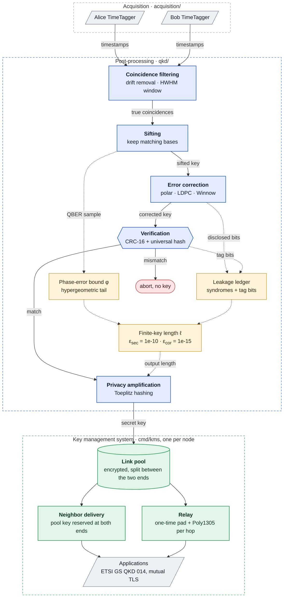

### qkd_post_processing

Classical post-processing for entanglement-based (BBM92) quantum key distribution, from raw TimeTagger timestamps to finite-key-certified secret keys, and the key management system that stores them per QKD link and delivers them to applications across a network of trusted nodes. Every node runs in Docker and is operated entirely from its web dashboard.



Solid arrows carry key material; dotted arrows carry public information that only sets the final key length.

### Repository layout

| Path | Contents |
|---|---|
| `qkd/` | the post-processing library (package `qkd`), one file per stage |
| `kms/` | the encrypted key store: single delivery, reservation for one application pair, wiping, pool split |
| `relay/` | hop-by-hop key relay: one-time pad and Poly1305, both keyed from QKD output |
| `cmd/kms/` | the key management system, one instance per node: ETSI GS QKD 014, node-to-node coordination, relay, audit |
| `cmd/qkdpki/` | the network CA, node credential bundles, application certificates, the shared network description |
| `cmd/importtt/` | the chain on a real dual-TimeTagger recording |
| `cmd/qkd_post_processing/` | the chain on simulated click streams |
| `cmd/tuneblock/` | compares block-discard generator matrices |
| `acquisition/` | Python: TimeTagger recording, clock alignment, CHSH diagnostic ([`acquisition/README.md`](acquisition/README.md)) |
| `evaluation/` | evaluates any recordings through the whole chain, one report with figures per pair and a pooled summary per link ([`evaluation/README.md`](evaluation/README.md)) |
| `ec/`, `pyec/` | 5G NR LDPC, the one-way error correction for two-party extraction: matrices from `py3gpp`, belief propagation from `ldpc`, run as a Python service the Go pipeline drives (`doc/ec_comparison.md`) |
| `ui/` | the node dashboard (Flask) |
| `deploy/` | one node's containers, `setup.sh`, `trust-ca.sh` ([`doc/deployment.md`](doc/deployment.md)) |
| `doc/` | procedures, security analysis, key management, deployment, code reference |
| `scripts/` | `test.sh`, `tune-blocksize.sh`, `cross_check_toeplitz.py`, `ec_compare.py` |
| `references/` | vendor documents, local only: ignored by git and Docker and refused by the pre-commit hook |

### Quick start

```bash
go build ./...
go test ./...
go run ./cmd/qkd_post_processing -n 1200000 -err 0.02 -polar
```

Requires Go 1.24 for local builds; the only Go dependency is `golang.org/x/crypto` (Poly1305). 5G NR LDPC also needs Python with `pip install -r ec/requirements.txt` (`QKD_EC_PYTHON` names the interpreter); the Docker images include it. Run `git config core.hooksPath .githooks` once per clone to enable the hook that keeps vendor documents out of every commit.

### Running the network

```bash
cd deploy
./setup.sh ca                                   # once, on the administration machine
./setup.sh node A a.example.org,192.0.2.1         # credentials, login and settings for node A
./setup.sh node B b.example.org,192.0.2.2
./setup.sh link A B                             # a QKD link between A and B
./setup.sh bundle A                             # nodes/A.tar.gz, to copy to node A
# on node A, inside a clone of this repository:
./setup.sh install A.tar.gz && ./setup.sh up A
```

Each node runs three hardened containers: `kms` (the key management system, a 13 MB distroless image, the only holder of the node's key and master key), `app` (the dashboard and the post-processing) and `ui` (HTTPS with a certificate from the network CA, behind a login). Trust the CA once with `./trust-ca.sh`, then every node's dashboard opens without warnings. Images build for amd64 and arm64 from the same `Dockerfile`. [`doc/deployment.md`](doc/deployment.md) is the full guide.

### What a node does from its dashboard

- **Acquisition**: load the TimeTagger config, record from both sites, and watch the coincidence peak live while the TimeTaggers stream: the tracker locks onto the lag and clock skew within seconds, then shows the clock-corrected peak, its HWHM, the true-pair rate and the accidentals as they evolve. Stored recordings can be replayed through the same tracker.
- **Recordings**: upload recordings copied off remote boxes; pairs are recognized by their shared start time.
- **Alignment**: coincidence-peak lag, window, score and clock skew for any pair, with zoomable plots.
- **Two-party key extraction**: the production mode; this node announces its own recordings' timing to a neighbor, which aligns, matches and decodes with its own, and both pools receive the same certified key under the same key_IDs.
- **Key extraction**: the chain on one pair or several pooled at one site, as a background job with a live log; detector delay calibration.
- **Continuous QKD**: records without end and distils a key block every few minutes into a link's KMS pool, with the current block's progress, per-segment QBER, rate, skew and processing time, and every block's disclosure, efficiency and key. A replay of two stored recordings stands in for the TimeTaggers.
- **Evaluation**: every stage of the chain on chosen recordings, with figures, kept on the node.
- **Network and KMS**: links and their reachability, each end's half of every pool, routes, applications, an end-to-end ETSI key exchange between two dashboards (key IDs and fingerprints only), the audit trail.
- **CHSH diagnostic** and the **simulator**, whose demo keys never reach the KMS.

### Real detector data from the command line

```bash
cd acquisition
python3 tt_record_dual.py                       # record from both TimeTaggers, tracking the peak live
python3 coincidence_peak.py <recording dir>     # coarse clock offset and skew
cd ..
go run ./cmd/importtt -dir acquisition/<recording dir> -cascade
```

`importtt` filters coincidences (drift removal, window from the half width at half maximum of a Gaussian fit to the peak, [`doc/coincidence_filtering.md`](doc/coincidence_filtering.md)), corrects errors (`-cascade`, optimized Cascade, the least disclosure, f 1.03 to 1.08; `-ldpc5g`, 5G NR LDPC, the best one-way method, for two-party; `-polar`, `-ldpc`, `-winnow`, or block discard; `-soft-bins 16` adds timing-aware decoding, [`doc/timing_aware_reconciliation.md`](doc/timing_aware_reconciliation.md)), verifies with CRC-16 and a universal hash, and sizes the key by the finite-key bound at $\varepsilon_\mathrm{sec} = 10^{-10}$, $\varepsilon_\mathrm{cor} = 10^{-15}$ ([`doc/finite_key_procedure.md`](doc/finite_key_procedure.md)). `-dir a,b,c` pools recordings into one block, `-keystore dir` writes the key as ETSI 014 records, `-json` prints one report, and `-window-sweep 50,100,...` adds sifted bits and QBER for each window from the same load.

A single recording of a few seconds is too short for a finite key; continuous mode distils blocks of minutes (Continuous QKD below), and `evaluation/evaluate.py` follows any recording through every stage with figures, kept locally, never committed. Fine timestamps must be announced in one direction only (Alice to Bob), see Per-detector delays and the timing side channel in [`doc/coincidence_filtering.md`](doc/coincidence_filtering.md).

### Continuous QKD

```bash
cd acquisition
python3 tt_record_dual.py --stop-mode continuous --segment-s 10 --output-dir run/            # until Ctrl+C
python3 continuous_qkd.py run/ --block-s 300 --keystore ../ui/import/<neighbor>             # beside it
python3 tt_record_dual.py --stop-mode continuous --replay A.npy B.npy --output-dir run/      # without TimeTaggers
```

The recorder writes one recording pair per segment, each complete before it appears. The processor follows them: every segment is aligned from a clock model, the first from the recorder's live tracker and every later one from the segment before, which also keeps only the clicks within 50 ns of a possible partner (a fraction of a percent of a busy detector's), so a 10 s segment of a 3 MHz detector is aligned and sifted in about 0.3 s; the full search runs only when there is no model or it fails. Each segment's aligned events stay as about 1 MB (`importtt -events-cache`) and its raw arrays are deleted; every `--block-s` seconds of data the block goes through optimized Cascade, verification and finite-key privacy amplification into the KMS import directory while the next fills. Blocks of 5 minutes reach about 70% of the key rate of hour-long ones ([`doc/finite_key_procedure.md`](doc/finite_key_procedure.md)); a stopped processor resumes from `continuous_state.json`. Details in [`acquisition/README.md`](acquisition/README.md).

### Applications

An application gets a certificate from `./setup.sh sae <SAE_ID> <NODE_ID>` and calls its node's KMS with ETSI GS QKD 014:

```bash
curl --cert sae.pem --key sae.key --cacert ca.pem \
    "https://a.example.org:8443/api/v1/keys/bob/enc_keys?number=2"
```

The answer's key_IDs go to the peer application, which fetches the same keys once from its own node at `/api/v1/keys/<master>/dec_keys`. Between neighbors the key is QKD pool material reserved at both ends; for distant nodes it is relayed hop by hop. [`doc/key_management.md`](doc/key_management.md) specifies the system.

### Library usage

```go
import (
	"qkd_post_processing/kms"
	"qkd_post_processing/qkd"
)

filtered, f, err := qkd.FilterCoincidences(alice, bob, qkd.DriftConfig{}, qkd.WindowConfig{})
res, err := qkd.RunPolar(alice, filtered, qkd.PolarRunConfig{
	CoincidenceWindowPS: f.WindowPS,
	RateMargin:          0.02,
	ListSize:            8,
	ChunkSize:           1024,
	ExpectedQBER:        f.PredictedQBER, // sizes the QBER sample automatically
})
// res.FinalKeyBytes is the key; res.FiniteKey records how its length was derived
saved, discarded, err := kms.SaveKeys256("keys/", res.FinalKeyBytes)
```

Every stage also has a one-sided form (for example `ComputeChunkCRC` and `ReconcileChunks`) for running Alice and Bob as separate processes.

### Documentation

| Document | Contents |
|---|---|
| [`doc/finite_key_procedure.md`](doc/finite_key_procedure.md) | the finite-key procedure, stage by stage, with parameters and measured results |
| [`doc/coincidence_filtering.md`](doc/coincidence_filtering.md) | drift removal, HWHM window, detector delays, timing side channel |
| [`doc/timing_aware_reconciliation.md`](doc/timing_aware_reconciliation.md) | per-bit reliabilities from public timing |
| [`doc/key_management.md`](doc/key_management.md) | the key management system: entities, protocols, lifecycle, limits |
| [`doc/security_proof.md`](doc/security_proof.md) | security of privacy amplification, pool use, relay, key delivery and storage |
| [`doc/deployment.md`](doc/deployment.md) | running the network: CA, nodes, links, applications, updates |
| [`doc/architecture.md`](doc/architecture.md) | code reference: every package, type and command |
| [`doc/ec_comparison.md`](doc/ec_comparison.md) | polar, regular LDPC and 5G NR LDPC measured side by side |

### Make and test

```bash
make build      # go build ./...
make test       # go test ./... -v
make test-all   # build, vet, fmt, race tests, cross-architecture build (scripts/test.sh)
make bench      # benchmarks only
make check      # fmt, vet, build, test, demo run
docker build --target tools -t qkd-tools .      # every command, for offline analysis
```
