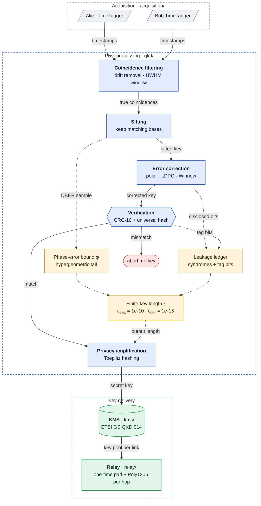

## qkd_post_processing

Classical post-processing for entanglement-based (BBM92) quantum key distribution,
from raw TimeTagger timestamps to a finite-key-certified secret key, plus a key
management server and a multi-hop key relay.



Solid arrows carry key material; dotted arrows carry public information that only
sets the final key length.

## Repository layout

| Path | Contents |
|---|---|
| `qkd/` | the post-processing library (package `qkd`), one file per stage, see below |
| `kms/` | key store: ETSI GS QKD 014 records, single delivery, encryption at rest |
| `relay/` | trusted-node relay: one-time pad + Poly1305, both keyed from QKD output, per hop |
| `cmd/importtt/` | runs the chain on a real dual-TimeTagger recording |
| `cmd/qkd_post_processing/` | runs the chain on simulated click streams |
| `cmd/kms-server/` | ETSI GS QKD 014 key delivery and relay endpoints, over mutual TLS |
| `cmd/tuneblock/` | compares block-discard generator matrices |
| `acquisition/` | Python: TimeTagger recording, clock alignment, CHSH diagnostic ([`acquisition/README.md`](acquisition/README.md)) |
| `ui/` | Flask dashboard, separate Docker + Caddy deployment ([`ui/deploy.md`](ui/deploy.md)) |
| `doc/` | formal procedures, security analysis, code reference; `doc/references/` holds the vendor PDFs |
| `scripts/` | `test.sh`, `tune-blocksize.sh`, `cross_check_toeplitz.py` (NumPy cross-check of the Toeplitz hash) |

Inside `qkd/`, by stage:

| Stage | Files |
|---|---|
| Events and sifting | `events.go`, `sifting.go` |
| Coincidence filtering | `coincfilter.go` (drift removal, Gaussian-fit HWHM window), `detdelay.go` (detector delays) |
| Error correction | `polar.go`, `ldpc.go`, `winnow.go`, `softrecon.go` (timing-aware), `blockdetect.go`, `bch.go`, `matrixsearch.go` |
| Verification and QBER | `crcverify.go`, `universalhash.go`, `qber.go`, `windowreport.go` |
| Privacy amplification | `finitekey.go` (finite-key length), `privacyamp.go`, `toeplitz.go`, `toeplitz_clmul_amd64.*` |
| Orchestration | `pipeline.go` (`Run`), `pipeline_winnow.go`, `pipeline_ldpc.go`, `pipeline_polar.go`, `epoch.go` |

## Quick start

```bash
go build ./...
go test ./...
go run ./cmd/qkd_post_processing -n 1200000 -err 0.02 -polar
```

Requires Go 1.24. The only external dependency is `golang.org/x/crypto` (Poly1305).

## Real detector data

```bash
cd acquisition
python3 tt_record_dual.py                       # record from both TimeTaggers
python3 coincidence_peak.py <recording dir>     # coarse clock offset and skew
cd ..
go run ./cmd/importtt -dir acquisition/<recording dir> -polar
```

`importtt` then runs, with these defaults:

1. **Coincidence filtering** (`-filter`): removes the residual clock drift between
   the sites and sets the window to the half width at half maximum of a Gaussian
   fit to the coincidence peak, from public timing only
   ([`doc/coincidence_filtering.md`](doc/coincidence_filtering.md)).
2. **Error correction**: `-polar` (rate-adaptive SC/SCL polar codes, recommended),
   `-ldpc`, `-winnow`, or block discard if none is given. `-soft-bins 16` adds
   timing-aware decoding ([`doc/timing_aware_reconciliation.md`](doc/timing_aware_reconciliation.md)).
3. **Finite-key privacy amplification** at $\varepsilon_\mathrm{sec} = 10^{-10}$,
   $\varepsilon_\mathrm{cor} = 10^{-15}$, with an automatically sized QBER sample
   ([`doc/finite_key_procedure.md`](doc/finite_key_procedure.md)).
   `-asymptotic` prints the asymptotic figure for comparison only.

Useful options:

| Option | Effect |
|---|---|
| `-dir a,b,c` | pool several recordings into one privacy-amplification block (all are used) |
| `-calibrate-delays file.json` | measure per-detector delays on a calibration recording, never used for key |
| `-detector-delays file.json` | apply those delays before sifting |
| `-keystore dir` | save the key as 256-bit ETSI 014 records |
| `-json` | one machine-readable report on stdout |

A single 10-second recording is too short for a finite key; on the
Bratislava-Trnava link the first certified bits appear at about one minute of
data (`doc/finite_key_procedure.md` §2.2). Fine timestamps must be announced in one
direction only (Alice to Bob), see `doc/coincidence_filtering.md` §4.

## Key management and relay

```bash
go run ./cmd/kms-server -generate-master-key master.key
go run ./cmd/kms-server -dir keys/ -master-key-file master.key \
    -tls-cert node.pem -tls-key node.key -tls-ca ca.pem
```

Serves ETSI GS QKD 014 `enc_keys`, `dec_keys` and `status`, each key delivered
once. With `-tls-ca`, clients must present a certificate signed by that CA. Adding
`-node-id`, `-relay-routes`, `-relay-peers` and `-relay-pools` enables multi-hop
relay: each hop re-encrypts with a fresh one-time pad and authenticates with a
fresh Poly1305 key, both drawn from that link's QKD key pool
([`doc/security_proof.md`](doc/security_proof.md)).

## Library usage

```go
import (
	"qkd_post_processing/kms"
	"qkd_post_processing/qkd"
)

filtered, f, err := qkd.FilterCoincidences(alice, bob, qkd.DriftConfig{}, qkd.WindowConfig{})
res, err := qkd.RunPolar(alice, filtered, qkd.PolarRunConfig{
	CoincidenceWindowPS: f.WindowPS,
	RateMargin:          0.02,
	ListSize:            8,
	ChunkSize:           1024,
	ExpectedQBER:        f.PredictedQBER, // sizes the QBER sample automatically
})
// res.FinalKeyBytes is the key; res.FiniteKey records how its length was derived
saved, discarded, err := kms.SaveKeys256("keys/", res.FinalKeyBytes)
```

Every stage also has a one-sided form (for example `ComputeChunkCRC` /
`ReconcileChunks`) for running Alice and Bob as separate processes.

## Documentation

| Document | Contents |
|---|---|
| [`doc/finite_key_procedure.md`](doc/finite_key_procedure.md) | the finite-key procedure, stage by stage, with parameters and measured results |
| [`doc/coincidence_filtering.md`](doc/coincidence_filtering.md) | drift removal, HWHM window, detector delays, timing side channel |
| [`doc/timing_aware_reconciliation.md`](doc/timing_aware_reconciliation.md) | per-bit reliabilities from public timing |
| [`doc/security_proof.md`](doc/security_proof.md) | security analysis of the privacy amplification, KMS and relay |
| [`doc/architecture.md`](doc/architecture.md) | code reference: every package, type and command |

## Make, test, Docker

```bash
make build      # go build ./...
make test       # go test ./... -v
make test-all   # build, vet, fmt, race tests, cross-architecture build (scripts/test.sh)
make bench      # benchmarks only
make check      # fmt, vet, build, test, demo run

docker build -t qkd-post-processing .
docker run --rm -v "$(pwd)/acquisition:/app/acquisition" qkd-post-processing \
    importtt -dir acquisition/example/20260909
```

The image has Python 3.12, Go 1.24 and the `qkd_post_processing`, `importtt` and
`tuneblock` binaries; it runs no server.
