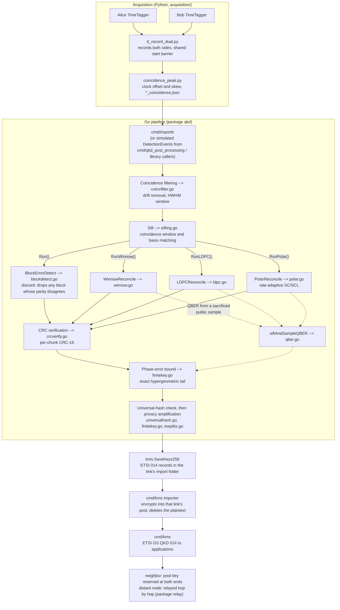
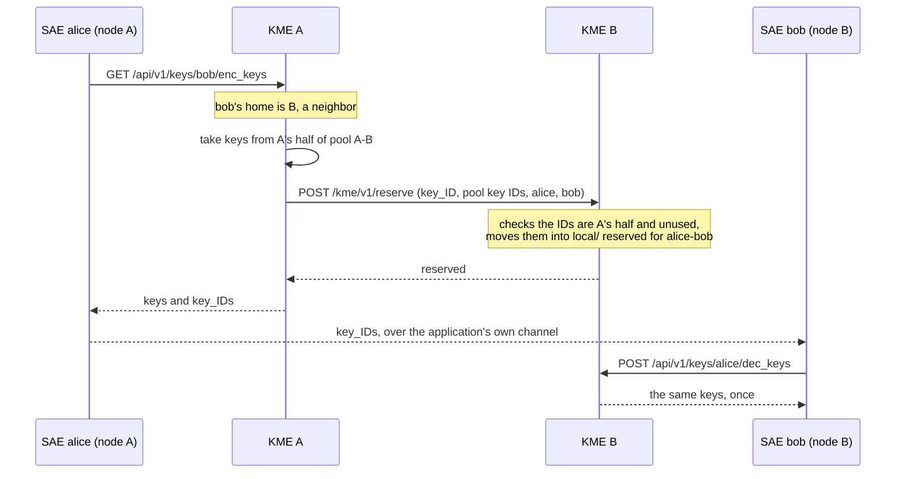

### Architecture

Scope: the structure of the codebase, meaning module boundaries, data flow, exported APIs and build and deployment mechanics. It is not a security proof: where a module makes a cryptographic or correctness claim, this document states it in one sentence and defers the justification to `security.md` and `key_management.md`. Code is cited by file and identifier, never by line.

### Overview

The repository implements the classical post-processing chain of a BBM92 entangled-photon QKD link and the key management system of a network of such links. Raw detector timestamps from two TimeTaggers go in; finite-key-certified secret keys come out, land in the pool of the QKD link that produced them, and are handed to applications through ETSI GS QKD 014, directly between neighbors or relayed across trusted nodes.

The chain has five logical stages (sifting, error reconciliation, error verification, phase-error estimation, privacy amplification), each a Go package-level function on plain `[]byte` bit arrays, composed by one of four `Run*` orchestrators according to the reconciliation strategy. Downstream of the distilled key and independent of how it was produced sit the key store (package `kms`), the relay (package `relay`) and the key management system itself (`cmd/kms`), one instance per network node.

The Go module `qkd_post_processing` (Go 1.24, `go.mod`) has three library packages: `qkd` (the post-processing chain), `kms` (the encrypted key store) and `relay` (hop-by-hop key relay, which imports `kms`); `qkd` imports neither. The one external dependency is `golang.org/x/crypto` (Poly1305). The Python scripts under `acquisition/` are a separate layer that writes the recordings `cmd/importtt` reads; the Go code never calls Python and the reverse holds too, except that the dashboard runs both.

### Top-level layout

| Path | Purpose |
|---|---|
| `qkd/` | Package `qkd`: sifting, coincidence filtering, reconciliation, verification, QBER, finite-key privacy amplification, orchestrators and their tests; `qkd/testdata/` holds fixed Toeplitz test vectors |
| `kms/` | Package `kms`: the encrypted key store with an in-memory index, single delivery, reservation for one SAE pair, wiping and tombstones; ETSI 014 key records |
| `relay/` | Package `relay`: hop-by-hop relay, one-time pad plus Poly1305 per hop, each end of a link drawing only from its own half of the pool |
| `cmd/kms/` | The key management system, one instance (KME) per node: ETSI GS QKD 014 for applications, pool coordination and relay between nodes, management, importer, audit trail |
| `cmd/qkdpki/` | The network's private CA, per-node credential bundles, application certificates, and edits to the shared network description |
| `cmd/importtt/` | CLI: the full chain over real dual-TimeTagger recordings |
| `cmd/qkd_post_processing/` | CLI: the full chain over simulated click streams |
| `cmd/controller/` | The network controller: desired nodes, links and settings, each node's config in answer to its agent's heartbeat, the network view and its stats |
| `cmd/tuneblock/` | CLI: compares block-discard generator matrices on one fixed batch |
| `acquisition/` | Python: records from two TimeTaggers, finds their clock offset and skew, CHSH diagnostic |
| `ec/` | `ldpc5g.py`: the matrix work of 5G NR LDPC on `py3gpp` (TS 38.212 matrices) and `ldpc` (belief propagation), as a service (`serve`) for the Go pipeline and on its own for `scripts/ec_compare.py` |
| `pyec/` | Go client for that service: a pool of its processes implementing `qkd.LDPC5GBackend` |
| `services/` | The node's services from one image, each on its own port: agent, acquisition, processing, web (`services.md`) |
| `ui/` | The dashboard page the web service serves: template, script, styles, logo |
| `api/` | OpenAPI 3.1 of the controller and the node services |
| `deploy/` | Docker deployment: `compose.yml` (one node), `controller.yml`, `lab.yml`, `Caddyfile`, `setup.sh`, `trust-ca.sh` |
| `.github/` | CI, weekly drift checks, image releases, Dependabot |
| `doc/` | This document and the formal procedures |
| `references/` | Vendor documents, local only: ignored by git and Docker and refused by the pre-commit hook |
| `scripts/` | `release.sh` (tags a release), `tune-blocksize.sh`, `cross_check_toeplitz.py`, `ec_compare.py` |
| `Dockerfile`, `Makefile`, `go.mod`, `go.sum`, `ruff.toml`, `.golangci.yml` | Multi-stage build of the kms, app and tools images; `make` targets; module definition; lint settings |

### Data flow

Everything up to privacy amplification operates on one side's own bits plus the peer's public metadata (parities, CRCs, syndromes, frozen values, hash tags); the two sides never exchange raw key bits. `pipeline.go`, `pipeline_winnow.go`, `pipeline_ldpc.go` and `pipeline_polar.go` each provide an orchestrator (`Run`, `RunWinnow`, `RunLDPC`, `RunPolar`) that runs both sides together; real two-site operation uses the split, one-sided functions each stage exposes (`ComputeBlockParity`/`ReconcileBlocks`, `ComputeChunkCRC`/`ReconcileChunks` and so on), so Alice and Bob can run as processes that never share raw bits. In production the two sides run apart: `qkd/twoparty.go` implements the protocol over public messages, `importtt -role alice|bob` runs each site's half on its own recording, and the dashboards exchange the messages through their KMSs (How a link's pools are filled in `key_management.md`).

### Selecting a reconciliation strategy

The four strategies are mutually exclusive at the CLI level and structurally separate at the library level --> there is no shared "strategy" interface; each is its own top-level function with its own `*RunConfig` / `*RunResult` pair:

| Strategy | Entry point | Config type | Result type | CLI flag (`cmd/importtt`, `cmd/qkd_post_processing`) |
|---|---|---|---|---|
| Block discard (default) | `Run` (`pipeline.go`) | `Config` (`pipeline.go`) | `Result` (`pipeline.go`) | none (default); `-matrix bch` or `-search-matrix` picks the generator matrix |
| Winnow correction | `RunWinnow` (`pipeline_winnow.go`) | `WinnowRunConfig` (`pipeline_winnow.go`) | `WinnowRunResult` (`pipeline_winnow.go`) | `-winnow` |
| LDPC belief propagation | `RunLDPC` (`pipeline_ldpc.go`) | `LDPCRunConfig` (`pipeline_ldpc.go`) | `LDPCRunResult` (`pipeline_ldpc.go`) | `-ldpc` |
| Polar SC/SCL decoding | `RunPolar` (`pipeline_polar.go`) | `PolarRunConfig` (`pipeline_polar.go`) | `PolarRunResult` (`pipeline_polar.go`) | `-polar` |

`cmd/importtt/main.go` and `cmd/qkd_post_processing/main.go` both enforce that `-winnow`, `-ldpc`, `-polar`, and `-search-matrix` are mutually exclusive at flag-parsing time; `main()` then dispatches to exactly one of `runDiscardPipeline` / `runWinnowPipeline` / `runLDPCPipeline` / `runPolarPipeline` (plus `runEpochedPipeline` in `cmd/importtt`, discard-only). The four strategies differ structurally, not just parametrically: discard measures QBER from the blocks it already dropped (`CalculateQBER`, `qber.go`), while Winnow, LDPC, and polar never discard anything up front, so they measure QBER from a separate sacrificed public sample (`siftAndSampleQBER`, `qber.go`) taken before reconciliation runs.

Real post-processing uses optimized Cascade only: the default of both CLIs, and the only method the services, the dashboard and the evaluation run. Block discard (`-discard`, with `-matrix` or `-search-matrix`), Winnow, regular LDPC, polar and 5G NR LDPC stay in the library as legacy implementations, with their tests, for comparison (`doc/ec_comparison.md`).

### Pipeline stages

### Sifting

Purpose: from each side's raw detector clicks, find the subset that are basis-matched, unambiguous, single-photon coincidences --> the only clicks that can contribute key bits.

| Identifier | Signature | File |
|---|---|---|
| `DetectionEvent` | `struct { TimestampPS int64; Basis Basis; Bit byte; MultiPhoton bool }` | `events.go` |
| `Basis` | `type Basis uint8` | `events.go` |
| `PublicEvent` | `struct { TimestampPS int64; Basis Basis; MultiPhoton bool }` | `sifting.go` |
| `StripBit` | `func StripBit(events []DetectionEvent) []PublicEvent` | `sifting.go` |
| `MatchedPair` | `struct { AliceIdx, BobIdx int }` | `sifting.go` |
| `MatchCoincidences` | `func MatchCoincidences(alice, bob []PublicEvent, windowPS int64) []MatchedPair` | `sifting.go` |
| `SiftedBit` | `struct { AliceBit, BobBit byte; AliceIdx, BobIdx int }` | `sifting.go` |
| `Sift` | `func Sift(aliceEvents, bobEvents []DetectionEvent, windowPS int64) []SiftedBit` | `sifting.go` |

Inputs: two `[]DetectionEvent` (or, for the split one-sided form, two `[]PublicEvent`, since `MatchCoincidences` never needs the measured bit, only timestamp/basis/multi-photon-flag --> that is the point of the `PublicEvent`/`DetectionEvent` split: classical-channel-safe metadata is a distinct type from the secret bit value). Output: `[]SiftedBit` (bit values, for simulation) or `[]MatchedPair` (indices only, for the real two-sided protocol). Selectable parameter: `windowPS`, the coincidence window in picoseconds (`-window` in both CLIs). A click flagged `MultiPhoton` is excluded from matching entirely; a timestamp with more than one basis-matched candidate on the peer side within the window is dropped on both sides as ambiguous (`bobCandidateCount`, `sifting.go`).

### Coincidence filtering

Runs in `cmd/importtt` after clock alignment and before sifting (`-filter`, on by default), specified in `doc/coincidence_filtering.md`. It prunes Bob clicks that can never coincide, tracks the coincidence peak in 250 ms slices from public timing only, removes its drift iteratively with linear extrapolation, and sets the window half-width to the HWHM of a Gaussian fit to the corrected peak. On the real recordings the window narrows from 1-10 ns to ±38-41 ps and QBER falls from 20-43% to 5.2-9.4%. `-dir a,b,c` pools recordings into one PA block; `-calibrate-delays` / `-detector-delays` measure and remove per-detector delays.

| Identifier | Signature | File |
|---|---|---|
| `PruneToCoincidenceRange` | `func PruneToCoincidenceRange(alice, bob []DetectionEvent, radiusPS int64) []DetectionEvent` | `coincfilter.go` |
| `DriftConfig` | `struct { SliceDurationPS, SearchRadiusPS, BinPS int64; MinScore float64 }` | `coincfilter.go` |
| `DriftModel` | `struct { TimesPS []int64; OffsetsPS []float64; Slices int }` | `coincfilter.go` |
| `EstimateDrift` | `func EstimateDrift(alice, bob []PublicEvent, cfg DriftConfig) (DriftModel, error)` | `coincfilter.go` |
| `ApplyDrift` | `func ApplyDrift(bob []DetectionEvent, m DriftModel) []DetectionEvent` | `coincfilter.go` |
| `GaussianFit` | `struct { CentrePS, SigmaPS, Amplitude, Background float64; BinPS int64 }`, method `HWHM()` | `coincfilter.go` |
| `FilterCoincidences` | `func FilterCoincidences(alice, bob []DetectionEvent, cfg DriftConfig, wc WindowConfig) ([]DetectionEvent, CoincidenceFilter, error)` | `coincfilter.go` |
| `CalibrateDetectorDelays` | `func CalibrateDetectorDelays(alice, bob []DetectionEvent, radiusPS int64) (DetectorDelays, []PairPeak, error)` | `detdelay.go` |
| `ApplyDetectorDelays` | `func ApplyDetectorDelays(events []DetectionEvent, delays [2][2]float64) []DetectionEvent` | `detdelay.go` |
| `TimingLeakBits` | `func TimingLeakBits(peaks []PairPeak) float64` | `detdelay.go` |

### Error detection: block discard

Purpose: detect (never correct) errors in `m`-bit blocks of the sifted key via a shared linear generator matrix; a block whose parity disagrees is dropped whole, both sides' copies, never patched bit by bit.

| Identifier | Signature | File |
|---|---|---|
| `GeneratorMatrix` | `type GeneratorMatrix [][]byte` | `blockdetect.go` |
| `(GeneratorMatrix) BlockSize` | `func (g GeneratorMatrix) BlockSize() int` | `blockdetect.go` |
| `(GeneratorMatrix) ParityBits` | `func (g GeneratorMatrix) ParityBits() int` | `blockdetect.go` |
| `CascadeGeneratorMatrices` | `func CascadeGeneratorMatrices(g1, g2 GeneratorMatrix) (GeneratorMatrix, error)` | `blockdetect.go` |
| `ComputeBlockParity` | `func ComputeBlockParity(bits []byte, g GeneratorMatrix) [][]byte` | `blockdetect.go` |
| `ReconcileBlocks` | `func ReconcileBlocks(ownBits []byte, ownParity, peerParity [][]byte, blockSize int) BlockReconcileResult` | `blockdetect.go` |
| `BlockErrorDetect` | `func BlockErrorDetect(alice, bob []byte, g GeneratorMatrix) BlockDetectResult` | `blockdetect.go` |
| `BCHGeneratorMatrix` | `func BCHGeneratorMatrix(gfBits, t, blockSize int) (GeneratorMatrix, error)` | `bch.go` |
| `GeneratorMatrixBCHt2` | `var GeneratorMatrixBCHt2 = mustBCHGeneratorMatrix(6, 2, 32)` | `bch.go` |
| `SearchGeneratorMatrix` | `func SearchGeneratorMatrix(m, p int, aliceEvents, bobEvents []DetectionEvent, windowPS int64, chunkSize, iterations int, seed int64) (best GeneratorMatrix, bestKeyRate float64)` | `matrixsearch.go` |

Inputs: each side's own bit array plus a shared `GeneratorMatrix` (parity bit `i` is the XOR of the message bits `G` row `i` selects: `P = M·Gᵀ` mod 2). Output: `BlockDetectResult` with `SurvivingAlice`/`SurvivingBob` (kept blocks, concatenated) and `DiscardedAlice`/`DiscardedBob` (dropped blocks, fed to `CalculateQBER`). Selectable parameters: which matrix (`-matrix bch`, the only built-in name; `GeneratorMatrixBCHt2` is a 32-bit-block, Hamming-weight-2 guaranteed-detection BCH matrix) or `-search-matrix` (hill-climbs a matrix directly against key rate via `SearchGeneratorMatrix`, with its own `-search-m`/`-search-p`/`-search-iterations`/`-search-seed` and, critically, `-search-offline-err`/`-search-offline-n` --> the search must run on independent proxy data, never the real session's own bits, or the matrix choice itself leaks information `PrivacyAmplify` never accounts for; both CLIs enforce this ordering automatically). `CascadeGeneratorMatrices` stacks two matrices' rows to catch collisions invisible to either alone.

### Error correction: Winnow

Purpose: correct (not merely detect) single-bit errors per block via Hamming-code syndrome comparison, across one or more passes with different block sizes and permutations, trading more classical-channel leakage for not discarding correct bits alongside errors.

| Identifier | Signature | File |
|---|---|---|
| `HammingGeneratorMatrix` | `func HammingGeneratorMatrix(blockSize int) (GeneratorMatrix, error)` | `winnow.go` |
| `WinnowCorrect` | `func WinnowCorrect(ownBits []byte, g GeneratorMatrix, referenceSyndrome [][]byte) (corrected []byte, flipped int)` | `winnow.go` |
| `WinnowConfig` | `struct { BlockSizes []int; Permutations [][]int }` | `winnow.go` |
| `WinnowReconcile` | `func WinnowReconcile(alice, bob []byte, cfg WinnowConfig) (correctedBob []byte, totalLeaked, totalCorrections int)` | `winnow.go` |
| `GeneratePermutation` | `func GeneratePermutation(n int, seed int64) []int` | `winnow.go` |
| `WinnowRunConfig` | `struct { ...; WinnowBlockSizes []int; Seed int64; ChunkSize int; KeyAlignBits int }` | `pipeline_winnow.go` |
| `RunWinnow` | `func RunWinnow(aliceEvents, bobEvents []DetectionEvent, cfg WinnowRunConfig) (WinnowRunResult, error)` | `pipeline_winnow.go` |

Inputs: sifted bits remaining after a random public sample is sacrificed for QBER (`siftAndSampleQBER`); a list of per-pass Hamming block sizes (`-winnow-blocks`, default `"25,50,100"`) and matching permutations (derived from `Seed`). Output: `WinnowRunResult` carrying `WinnowCorrections` (bits flipped), `WinnowLeakedBits` (syndrome bits disclosed), and the usual `FinalKeyBits`/`FinalKeyBytes`. Selectable parameters: `-winnow-blocks` (one Hamming block size per pass --> larger blocks correct fewer, smaller errors leak fewer bits per pass; multiple passes with different permutations catch errors a single pass's one-error-per-block model misses), `-winnow-sample` (fraction of sifted bits sacrificed for the direct QBER sample, default 0.05, overridden by the automatic sample size `-sample-auto` in finite-key mode). Winnow's one-error-per-block model can still miss a block with two or more errors; the CRC pass (Error verification, below) catches most of what it misses.

### Error correction: LDPC

Purpose: correct errors via one LDPC syndrome reveal per block, decoded by normalized min-sum belief propagation, instead of Winnow's multi-pass syndrome exchange.

| Identifier | Signature | File |
|---|---|---|
| `LDPCMatrix` | `struct { N, M int; Wc, Wr int; CheckVars [][]int32; ... }` | `ldpc.go` |
| `BuildRegularLDPC` | `func BuildRegularLDPC(n, wc, wr int, seed int64) (*LDPCMatrix, error)` | `ldpc.go` |
| `BuildPEGLDPC` | `func BuildPEGLDPC(n, wc, wr int, seed int64) (*LDPCMatrix, error)` | `ldpc.go` |
| `(*LDPCMatrix) Syndrome` | `func (h *LDPCMatrix) Syndrome(bits []byte) []byte` | `ldpc.go` |
| `LDPCDecodeConfig` | `struct { MaxIterations int }` | `ldpc.go` |
| `LDPCDecode` | `func LDPCDecode(h *LDPCMatrix, receivedBits, syndrome []byte, qber float64, cfg LDPCDecodeConfig) (corrected []byte, converged bool, iterations int)` | `ldpc.go` |
| `LDPCReconcile` | `func LDPCReconcile(h *LDPCMatrix, alice, bob []byte, qber float64, cfg LDPCDecodeConfig) (correctedBob []byte, convergedBlocks, totalBlocks, leakedBits int)` | `ldpc.go` |
| `LDPCRunConfig` | `struct { ...; BlockLength int; ColWeight int; RowWeight int; MaxIterations int; Seed int64; ... }` | `pipeline_ldpc.go` |
| `RunLDPC` | `func RunLDPC(aliceEvents, bobEvents []DetectionEvent, cfg LDPCRunConfig) (LDPCRunResult, error)` | `pipeline_ldpc.go` |

Inputs: same QBER-sample-then-reconcile structure as Winnow. `BuildRegularLDPC` constructs a Gallager-style regular sparse parity-check matrix with 4-cycle avoidance up to a cost cap (`ldpcCycleAvoidanceMaxPairs`, `ldpc.go`); `BuildPEGLDPC` is an alternative Progressive Edge Growth construction that directly maximizes local girth (available as a library function; not wired to a CLI flag in either `cmd/importtt` or `cmd/qkd_post_processing`). Output: `LDPCRunResult` carrying `LDPCBlocks`/`LDPCConverged` (syndrome satisfied within the iteration cap) /`LDPCLeakedBits`. Selectable parameters: `-ldpc-block` (codeword length, 0 = one block spanning the whole remaining key), `-ldpc-wc`/`-ldpc-wr` (column/row weight; code rate is `1-wc/wr`, which Error correction methods in `doc/security.md` recommends tuning comfortably --> not marginally --> below `1-h2(QBER)`, since a finite-degree regular code's real decoding threshold runs below the Shannon bound), `-ldpc-iterations` (belief propagation cap per block, 0 = default 50, `defaultLDPCMaxIterations`, `ldpc.go`), `-ldpc-sample` (QBER sample fraction, default 0.05).

### Error correction: polar codes

Purpose: correct errors with one disclosure per block and a single-pass, non-iterative decoder, following Arıkan (2009) and its QKD reconciliation use in Jouguet and Kunz-Jacques (2014), with successive-cancellation list (SCL) decoding per Tal and Vardy (2012) and its QKD evaluation in Yan et al. (2018).

| Identifier | Signature | File |
|---|---|---|
| `PolarTransform` | `func PolarTransform(bits []byte) ([]byte, error)` | `polar.go` |
| `PolarCode` | `struct { N, K int; Frozen []bool; FrozenIdx []int }` | `polar.go` |
| `BuildPolarCode` | `func BuildPolarCode(n, k int, designQBER float64) (*PolarCode, error)` | `polar.go` |
| `PolarDecodeConfig` | `struct { ListSize int }` | `polar.go` |
| `PolarSCDecode` | `func PolarSCDecode(code *PolarCode, receivedBits, frozenVals []byte, qber float64, cfg PolarDecodeConfig) ([]byte, error)` | `polar.go` |
| `PolarPass` | `func PolarPass(code *PolarCode, alice, bob []byte, qber float64, cfg PolarDecodeConfig) (PolarReconcileResult, error)` | `polar.go` |
| `PolarReconcile` | `func PolarReconcile(code *PolarCode, alice, bob []byte, qber float64, cfg PolarDecodeConfig) (correctedBob []byte, totalBlocks, bitsCorrected, leakedBits int, err error)` | `polar.go` |
| `PolarRunConfig` | `struct { ...; BlockLength int; RateMargin float64; ListSize int; Seed int64; ... }` | `pipeline_polar.go` |
| `RunPolar` | `func RunPolar(aliceEvents, bobEvents []DetectionEvent, cfg PolarRunConfig) (PolarRunResult, error)` | `pipeline_polar.go` |

**Protocol**: each sifted bit is modelled as passing through a binary symmetric channel with crossover probability equal to the sampled QBER.

Alice applies the polar transform $G_N = F^{\otimes n}$ (no bit-reversal permutation, so the transform is its own inverse) to each $N$-bit block and discloses the values at the $N-K$ least reliable positions. Bob decodes from his own bits' channel LLRs plus those disclosed values, then applies the same transform to recover Alice's block. Leaked bits are exactly $N-K$ per block, the same role as LDPC's syndrome.

**Construction**: positions are ranked by the Gaussian approximation (Trifonov 2012), started from the LLR mean of a BI-AWGN channel whose capacity equals the BSC's ($1-h_2(\mathrm{QBER})$). The simpler Bhattacharyya bound was measured to give a 2.3× x higher block failure rate at $N=1024$ and is not used.

**Decoding**: for $x = (T(u_1)\oplus T(u_2),\ T(u_2))$ the decoder recovers $u_1$ from $f(L_\text{left}, L_\text{right})$, re-encodes it, then recovers $u_2$ from $g(L_\text{left}, L_\text{right}, T(\hat u_1))$, recursively. $f$ is the min-sum approximation and the SCL path metric is the approximate LLR form of Balatsoukas-Stimming et al. (2015); list size 1 takes a zero-allocation plain-SC path. Selectable parameters: `-polar-n` (block length, a power of two, 0 = largest covering the remaining key), `-polar-margin` (starting rate margin below $1-h_2(\mathrm{QBER})$, default 0.02; a block whose hash fails is retried with the margin raised by 0.02, revealing only the extra frozen values), `-polar-list` (SCL list size $L$, default 8, 1 = plain SC), `-polar-sample` (QBER sample fraction, default 0.05).

**Measured behaviour**:

| Check | Result |
|---|---|
| SC vs. brute-force ML decoding, $N=4$ and $N=8$, QBER 8% | success 0.853 vs 0.850, 0.897 vs 0.895 |
| Reliability ordering vs. measured genie error rate, $N=64$ | Spearman $\rho = 0.987$ |
| Block failure, $N=1024$, QBER 3%, rate 0.656 | SC 9.8%, SCL ($L=16$) 2.4% |
| Decode time, $2^{20}$ bits, QBER 3%, rate 0.7 | LDPC 0.30 s, polar SC 0.13 s, polar SCL ($L=8$) 1.13 s |

**Tradeoff**: Plain SC is faster than this codebase's LDPC decoder and has no non-convergence mode, but at short-to-moderate $N$ it fails more blocks than its rate suggests; SCL closes much of that gap at roughly $L$ times SC's cost. A failed block is not silently accepted: it leaves residual errors that the CRC stage drops. Systematic encoding and CRC-aided list decoding, both used in the literature, are not implemented.

### Timing-aware soft reconciliation

An option on the LDPC and polar strategies (`TimingBins` in `LDPCRunConfig` / `PolarRunConfig`, CLI `-soft-bins`), specified formally in `doc/timing_aware_reconciliation.md`. Each sifted bit's public arrival-time offset $\Delta t$ selects its own error rate $q(\Delta t)$, estimated per bin from the sacrificed QBER sample, and the decoder starts from per-bit LLRs instead of one flat QBER. By Jensen's inequality the disclosure bound can only fall. LDPC discloses the same syndrome and converges more blocks; polar also builds each block's code and rate from its bits' $q_i$, so it discloses less. Privacy amplification is unchanged.

| Identifier | Signature | File |
|---|---|---|
| `TimingErrorModel` | `struct { WindowPS int64; ErrorRate []float64; Counts, Errors []int }` | `softrecon.go` |
| `EstimateTimingErrorModel` | `func EstimateTimingErrorModel(sampleAlice, sampleBob []byte, sampleDt []int64, windowPS int64, bins int) (TimingErrorModel, error)` | `softrecon.go` |
| `SoftLLRs` | `func SoftLLRs(receivedBits []byte, q []float64) []float64` | `softrecon.go` |
| `SlepianWolfBounds` | `func SlepianWolfBounds(q []float64) (soft, flat float64)` | `softrecon.go` |
| `PolarReconcileSoft` | `func PolarReconcileSoft(alice, bob []byte, q []float64, blockLength int, margin float64, cfg PolarDecodeConfig) (...)` | `softrecon.go` |
| `LDPCReconcileSoft` | `func LDPCReconcileSoft(h *LDPCMatrix, alice, bob []byte, q []float64, cfg LDPCDecodeConfig) (...)` | `softrecon.go` |
| `TimingReport` | `struct { Model TimingErrorModel; SoftBound, FlatBound float64 }` | `softrecon.go` |

### Error verification

Purpose: a cheap, fast second check over the EC-surviving stream, to catch what error correction itself missed (a block whose decode converged to the wrong codeword, a two-error Winnow block, etc.).

| Identifier | Signature | File |
|---|---|---|
| `CRCVerifyResult` | `struct { SurvivingAlice, SurvivingBob, DiscardedAlice, DiscardedBob []byte; ChunksTotal, ChunksKept, ChunksDropped, LeakedBits int }` | `crcverify.go` |
| `ComputeChunkCRC` | `func ComputeChunkCRC(bits []byte, chunkSize int) []uint16` | `crcverify.go` |
| `ReconcileChunks` | `func ReconcileChunks(ownBits []byte, ownCRC, peerCRC []uint16, chunkSize int) ChunkReconcileResult` | `crcverify.go` |
| `CRCVerify` | `func CRCVerify(alice, bob []byte, chunkSize int) CRCVerifyResult` | `crcverify.go` |

Inputs: the EC-surviving bit stream, plus `chunkSize` in bits (`-chunk`). Algorithm: CRC-16/CCITT-FALSE (`crc16Poly = 0x1021`, `crcverify.go`) computed per chunk, 16 bits leaked per surviving chunk. Selectable parameter: `-chunk` --> discard's default is 2048 bits; Winnow/LDPC need a much smaller value (the CLIs' help text suggests ~128) since without an upfront discard step, a large CRC chunk containing even one residual error discards far more good bits per catch. Claim (one sentence; `doc/security.md` gives the justification): CRC-16 alone bounds correctness only to about `2⁻¹⁶`, which is why `universalhash.go` (see Finite-key sizing) exists as a stronger check immediately before privacy amplification.

### QBER estimation

Purpose: produce the single error-rate number that privacy amplification's Devetak-Winter / finite-key rate formula consumes.

| Identifier | Signature | File |
|---|---|---|
| `QBERResult` | `struct { ErrorBits, SampleBits int; QBER float64 }` | `qber.go` |
| `siftAndSampleQBER` (unexported) | `func siftAndSampleQBER(aliceEvents, bobEvents []DetectionEvent, windowPS int64, sampleFraction float64, seed int64) (siftedBits int, aliceRem, bobRem []byte, qber QBERResult)` | `qber.go` |
| `CalculateQBER` | `func CalculateQBER(discardedAliceBlocks, discardedBobBlocks []byte, siftedBits int) QBERResult` | `qber.go` |

Two distinct estimators, one per reconciliation family: `CalculateQBER` (used by `Run`) reads the error rate off the blocks block-discard already dropped, over the whole sifted key; `siftAndSampleQBER` (used by `RunWinnow`, `RunLDPC` and `RunPolar`) measures a direct, unbiased rate from a random public sample taken before reconciliation runs, since the residual error rate after correction is exactly what correction just tried to drive to zero and so cannot be used to estimate its own input error rate.

### Privacy amplification

Purpose: compress the error-free, verified bit stream down to a length short enough that an eavesdropper's information about it is negligible, via a two-universal (Toeplitz) hash family.

| Identifier | Signature | File |
|---|---|---|
| `SecureKeyLength` | `func SecureKeyLength(n int, qber float64, leakedBits int) int` | `privacyamp.go` |
| `PrivacyAmplify` | `func PrivacyAmplify(errorFreeBits []byte, qber float64, leakedBits, alignBits int) (key []byte, seed []byte, err error)` | `privacyamp.go` |
| `toeplitzHashFast` (unexported) | `func toeplitzHashFast(x []byte, seed []byte, l int) []byte` | `toeplitz.go` |
| `toeplitzSeed` (unexported) | `func toeplitzSeed(l, n int) ([]byte, error)` | `toeplitz.go` |
| `FiniteKeySecureKeyLength` | `func FiniteKeySecureKeyLength(n int, phi float64, leakedBits int, epsCor, epsPA float64) int` | `finitekey.go` |
| `FiniteKeyConfig` | `struct { EpsSec, EpsCor float64 }` | `finitekey.go` |
| `FiniteKeyReport` | `struct { PhiPoint, Phi float64; TagBits int; Verified bool; LeakedBits, Length int }` | `finitekey.go` |

Two accounting modes, chosen per run:

- **Finite-key (default for Winnow, LDPC and polar)**: `distillFiniteKey` bounds the phase error of the kept bits across bases (key bits of each basis from the other basis's sample errors, plus the fluctuation term at $\varepsilon_\text{PE}/2$, scaled up for CRC-dropped chunks), verifies the two surviving strings with a $\log_2(1/\varepsilon_\text{cor})$-bit universal hash (no key on mismatch), and hashes to `FiniteKeySecureKeyLength`'s length. CLI: `-eps-sec` (default $10^{-10}$), `-eps-cor` (default $10^{-15}$).
- **Asymptotic** (`-asymptotic`, and always for block discard, which has no random sample): `SecureKeyLength` = $n(1 - h_2(\mathrm{QBER}))$ minus the bits actually disclosed. The earlier form $n(1 - 2h_2)$ minus disclosure charged error correction twice and was corrected.

A phase-error bound at or above $\tfrac12$ yields no key in both modes; the earlier clamp at 1 would have certified the whole block, since $h_2(1) = 0$. `toeplitzHashFast` dispatches to a hardware-CLMUL implementation (`toeplitzHashCLMUL`, `toeplitz_clmul_amd64.go`) on amd64 CPUs that support `PCLMULQDQ`, falling back to a POPCNT-based implementation (`toeplitzHashPopcount`, `toeplitz.go`) elsewhere; both compute the same function, verified against each other and against a reference `O(ln)` implementation (`toeplitzHashNaive`, `toeplitz.go`, test-only) in `toeplitz_test.go`/`toeplitz_vectors_test.go`. Selectable parameter: `alignBits` / `-keystore` implies `KeyAlignBits = ETSI014KeySizeBits` (256) so a caller chunking the key into fixed-size records afterward never discards a partial-record remainder.

### Window and epoch reporting

Purpose: two read-only / structural diagnostics layered on top of the chain above, neither of which feeds back into which bits become key material except as noted.

| Identifier | Signature | File |
|---|---|---|
| `WindowReportConfig` | `struct { BucketPS int64; MinPairs int }` | `windowreport.go` |
| `WindowBucketReport` | `struct { StartPS int64; PairCount int; QBER float64; Reportable bool }` | `windowreport.go` |
| `ReportWindowQuality` | `func ReportWindowQuality(aliceEv, bobEv []DetectionEvent, pairs []MatchedPair, cfg WindowReportConfig) []WindowBucketReport` | `windowreport.go` |
| `EpochResult` | `struct { StartPS int64; Result }` | `epoch.go` |
| `EpochedResult` | `struct { Epochs []EpochResult; FinalKeyBits, FinalKeyBytes []byte }` | `epoch.go` |
| `RunEpoched` | `func RunEpoched(aliceEvents, bobEvents []DetectionEvent, cfg Config, epochPS int64) (EpochedResult, error)` | `epoch.go` |

`ReportWindowQuality` (`cmd/importtt -window-report`) buckets already-sifted pairs by elapsed time and reports each bucket's own QBER --> diagnostic only; it never selects which bits become key, precisely because doing so after seeing per-bucket QBER would be the kind of post-selection bias the phase-error estimate in `doc/security.md` and `EstimatePhaseError`'s `conservative` parameter exist to guard against. `RunEpoched` (`cmd/importtt -epoch-s`) is structural, not diagnostic: it reruns the entire discard-only `Run` chain independently once per fixed time epoch instead of pooling a whole recording into one QBER estimate, so a noisy epoch contributes zero key bits on its own account rather than being silently averaged in or excluded after the fact. It is wired to the block-discard path only --> `cmd/importtt` refuses `-epoch-s` together with `-winnow`/`-ldpc`/`-search-matrix` (`cmd/importtt/main.go`).

### Finite-key sizing

`finitekey.go` is the non-asymptotic replacement for `SecureKeyLength` (`privacyamp.go`); `doc/security.md` is the authoritative, formal procedure this module implements --> this section describes the Go API surface only, not the derivation. Do not treat anything below as re-deriving or superseding that document.

| Identifier | Signature | File | Operational meaning of its parameters |
|---|---|---|---|
| `PhaseErrorEstimate` | `struct { Mu, Phi float64; Conservative bool }` | `finitekey.go` | `Mu`: the statistical fluctuation term; `Phi`: the phase-error bound to feed into `FiniteKeySecureKeyLength`; `Conservative`: whether the post-selection-bias correction (below) was applied |
| `EstimatePhaseError` | `func EstimatePhaseError(q float64, ns, k int, epsPE float64, nSifted, nSurvivingEC int, conservative bool) PhaseErrorEstimate` | `finitekey.go` | `q`: measured error rate in the sacrificed **conjugate-basis** sample (not the same-basis error rate already being corrected); `ns`: same-basis block size; `k`: conjugate-basis sample size; `epsPE`: parameter-estimation confidence; `nSifted`/`nSurvivingEC`: used only when `conservative=true`, to scale `Phi` by how much of the sifted key survived error correction |
| `FiniteKeySecureKeyLength` | `func FiniteKeySecureKeyLength(n int, phi float64, leakedBits int, epsCor, epsPA float64) int` | `finitekey.go` | `n`: EC-surviving, verified bit count going into this PA block; `phi`: `EstimatePhaseError`'s output, a dedicated phase-error bound (not same-basis QBER); `leakedBits`: total classical disclosure already charged against this block (parity/syndrome bits, CRC bits, universal-hash tag bits); `epsCor`/`epsPA`: the two independent per-block security parameters |
| `SecurityBudget` | `struct { EpsPE, EpsPA, EpsCor float64 }` | `finitekey.go` | the three composable security parameters this procedure tracks per PA block |
| `SplitSecurityBudget` | `func SplitSecurityBudget(epsSec, epsCor float64) SecurityBudget` | `finitekey.go` | splits a target total secrecy failure probability `epsSec` into `EpsPE`/`EpsPA` (each `epsSec/3`) while keeping correctness (`epsCor`) tracked separately, per the procedure's own composition convention |

Use `conservative=true` in `EstimatePhaseError` unless and until bit and phase errors have been confirmed independent for the specific detector/source pair in use --> this is an explicit open item in the phase-error estimate in `doc/security.md`, not something either this module or this document resolves on its own. See `doc/security.md` for the full procedure, including recommended parameter values, PA block-size guidance, and the universal-hash correctness check (`universalhash.go`, run just before this stage) that this finite-key accounting depends on.

### Key store

`KMS` is one encrypted store: one JSON record per `key_ID` in a directory, indexed in memory when the store opens, so every lookup, draw and status call reads the index rather than the disk. A node has several: its delivery store (keys reserved for application pairs) and one pool per QKD link.

| Identifier | Signature or shape | File |
|---|---|---|
| `kmsRecord` (unexported) | `struct { KeyID, Ciphertext string; CreatedAt, ExpiresAt time.Time; Consumed bool; ConsumedAt time.Time; MasterSAE, SlaveSAE string }` | `kms.go` |
| `NewKMS` | `func NewKMS(dir string, masterKey []byte) (*KMS, error)` | `kms.go` |
| `(*KMS) Put`, `PutWithID` | `func (k *KMS) PutWithID(keyID string, keyBytes []byte, ttl time.Duration) error` | `kms.go` |
| `(*KMS) PutReserved` | `func (k *KMS) PutReserved(keyID string, keyBytes []byte, master, slave string, ttl time.Duration) error` | `kms.go` |
| `(*KMS) Get`, `GetReserved`, `CheckReserved` | `func (k *KMS) GetReserved(keyID, master, slave string) ([]byte, error)` | `kms.go` |
| `(*KMS) GetNext`, `GetNextMatching` | `func (k *KMS) GetNextMatching(n int, match func(string) bool) ([]DeliveredKey, error)` | `kms.go` |
| `(*KMS) GetNextBytes`, `GetNextBytesMatching` | `func (k *KMS) GetNextBytesMatching(n int, match func(string) bool) ([]byte, []string, error)` | `kms.go` |
| `(*KMS) GetBytes` | `func (k *KMS) GetBytes(ids []string, n int) ([]byte, error)` | `kms.go` |
| `(*KMS) Status`, `CountAvailable`, `AvailableIDs` | counts and IDs only, never key material | `kms.go` |
| `(*KMS) Sweep` | `func (k *KMS) Sweep() (int, error)` | `kms.go` |
| `OriginatorOf` | `func OriginatorOf(self, peer string) func(string) bool` | `kms.go` |
| `SaveKeys256`, `SaveKey`, `LoadKey`, `NewKeyID` | plaintext ETSI 014 records, the pipeline's output format | `keystore.go` |
| `EncryptWithKey`, `DecryptWithKey` | AES-256-GCM with an HKDF-SHA256-derived key | `encryption.go` |

Records are AES-256-GCM under the node's 32-byte master key, written atomically (temporary file, sync, rename) with mode `0o600` in a `0o700` directory. Delivery is single: taking a key wipes its ciphertext from disk and leaves a tombstone, `Sweep` does the same for expired keys, and a tombstoned `key_ID` can never be stored again. A key stored with `PutReserved` is invisible to every draw and goes only to its own master and slave SAE pair. `GetBytes` checks every listed ID before consuming any, so a bad list consumes nothing, and `GetNextBytesMatching` consumes nothing when the pool cannot cover the request. `OriginatorOf` splits a link's pool between its two ends by the parity of the first hex digit of each `key_ID`; the two ends' filters are exact complements, so no pool key is ever drawn by both.

### Key management system

One instance per node, the node's KME. It reads the network description every node shares (`network.json`: nodes and their KME URLs, QKD links, and the home node of every application), derives its neighbors and shortest-path routes from it (`nextHops`, breadth-first, ties to the alphabetically first neighbor), and opens `local/` plus `pools/<neighbor>/` under its data directory. `key_management.md` specifies the protocols; this section lists the surface.

| Route | Caller | Handler, file | Does |
|---|---|---|---|
| `GET /api/v1/keys/{slave}/status` | SAE of this node | `handleStatus`, `etsi.go` | ETSI Get Status for the pair, with the count deliverable now |
| `GET` or `POST /api/v1/keys/{slave}/enc_keys` | SAE of this node | `handleEncKeys`, `etsi.go` | ETSI Get Key: up to 128 keys, sizes multiples of 256 bits |
| `GET` or `POST /api/v1/keys/{master}/dec_keys` | SAE of this node | `handleDecKeys`, `etsi.go` | ETSI Get Key with Key IDs: every ID checked before any is delivered |
| `POST /kme/v1/reserve` | neighbor KME | `handleReserve`, `relay.go` | holds named pool keys of the sender's half for one SAE pair |
| `POST /kme/v1/relay` | the neighbor named in the packet | `handleRelay`, `relay.go` | authenticates, decrypts, stores (destination) or forwards |
| `GET /kme/v1/node` | any KME, or this node's admin | `handleNode`, `node.go` | counts per store and link; `?probe=1` (admin) checks every neighbor |
| `GET /kme/v1/network`, `/kme/v1/audit` | this node's admin | `handleNetwork`, `handleAudit`, `node.go` | the network description and routes; the newest audit events |
| `POST /kme/v1/pp/send`, `GET /kme/v1/pp/recv`, `GET /kme/v1/pp/sessions` | this node's admin | `mailbox.go` | two-party post-processing messages to and from a neighbor's dashboard |
| `POST /kme/v1/pp/inbox` | neighbor KME | `handlePPInbox`, `mailbox.go` | queues a neighbor's post-processing message |

Callers are identified by their client certificate alone: the organizational unit gives the role (`kme`, `sae` or `admin`) and the common name the ID, so an application certificate can never act as a node, a node never as an application, and a dashboard never as its node. Every answer from a peer is checked to come from the node it was sent to (`kmePost`, `relay.go`). Requests are capped at 1 MiB, post-processing messages at 128 MiB. Without `-tls-cert`, `-tls-key` and `-tls-ca` the server refuses to start unless `-insecure-plain-http` is given, which takes identities from headers and exists for development only.

For a slave whose home is not a neighbor, `relay.RelayNode.OriginateFromPool` takes the key from the master's half of the first link's pool and sends the first hop only its key_IDs, then `POST /kme/v1/relay` carries it hop by hop; the destination stores it reserved for the pair and answers with the `key_ID` the origin chose, and only then does the origin hand the key out. If the peer does not confirm, the keys already taken are destroyed and logged as burned, never delivered. `importKeys` (`node.go`) moves settled plaintext records from `<import-root>/<neighbor>/` into that link's pool every two seconds and deletes each file once it is stored encrypted; `runSweeper` wipes expired material every ten minutes; `auditLog` (`audit.go`) appends one JSON line per key event, with key and SAE IDs only.

### Relay

| Identifier | Signature | File |
|---|---|---|
| `RelayNode` | `struct { ID string; Local *kms.KMS; HopPools map[string]*kms.KMS; NextHop map[string]string }` | `relay.go` |
| `RelayedPacket` | `struct { Dest, FromHop, Origin, KeyID, MasterSAE, SlaveSAE string; PadKeyIDs, MACKeyIDs []string; Cipher, Tag []byte }` | `relay.go` |
| `(*RelayNode) Originate` | `func (n *RelayNode) Originate(dest, keyID, master, slave string, keyBytes []byte) (RelayedPacket, error)` | `relay.go` |
| `(*RelayNode) Receive`, `Handle` | `func (n *RelayNode) Handle(pkt RelayedPacket) (delivered bool, keyID string, next RelayedPacket, err error)` | `relay.go` |
| `RelayXOR` | `func RelayXOR(payload, pad []byte) ([]byte, error)` | `relay.go` |
| `ComputePolyMAC`, `VerifyPolyMAC` | Poly1305 under a single-use 32-byte key, constant-time comparison | `polymac.go` |

Each hop takes the pad and the MAC key in one draw from its own half of the pool shared with the next hop (`forward`), so a short pool consumes nothing. The MAC covers every field an attacker could change, destination, sender, origin, end-to-end `key_ID`, SAE pair, pad key IDs and ciphertext, each length-prefixed (`macMessage`). `Receive` refuses a packet whose pad or MAC keys come from the receiver's own half before consuming anything, verifies the tag before decrypting, and wipes pad and key buffers after use. A packet carries key IDs, never key material, and an intermediate node keeps nothing once it has forwarded.

### Build, test and deployment

### Makefile targets

| Target | Command | Purpose |
|---|---|---|
| `build` | `go build ./...` | compile everything |
| `test` | `go test -race -count=1 ./...` | the Go test suite, race detector on |
| `lint` | golangci-lint, `ruff check .` | Go and Python lint, as CI runs them |
| `pytest` | `python3 -m unittest ...` | the services' and acquisition's Python tests |
| `services` | `python3 -m services all` | every node service in one process, for development |
| `bench` | `go test -run '^$' -bench . -benchmem ./...` | benchmarks only |
| `tune` | `./scripts/tune-blocksize.sh` | block-size sweep for the discard strategy |
| `run` | `go run ./cmd/qkd_post_processing -n 300000 -err 0.005 -chunk 3000` | demo run |
| `vet`, `fmt` | `go vet ./...`, `gofmt -l .` | static analysis, formatting check |
| `check` | `fmt vet build test lint pytest` | what CI runs, locally |

### Commands

| Binary | Source | What it does |
|---|---|---|
| `kms` | `cmd/kms/` | the key management system of one node, see above |
| `controller` | `cmd/controller/` | the network controller (`services.md`): `state.go` the desired network and each node's config, `api.go` heartbeat, network view, events and stats, `main.go` mutual TLS |
| `qkdpki` | `cmd/qkdpki/main.go` | `ca` (network CA), `node` (kms, app and ui credentials plus master key), `sae` (application certificate), `controller` (controller and operator certificates), `net` (edit `network.json`) |
| `importtt` | `cmd/importtt/main.go` | loads a real recording (`npy.go`), aligns clocks with `coincidence_peak.py`'s affine model, maps channels to basis and bit, filters coincidences, runs the chosen chain; `-dir a,b,c` pools recordings, `-calibrate-delays` and `-detector-delays` handle per-detector delays, `-keystore` writes the key as ETSI records, `-json` prints one report |
| `qkd_post_processing` | `cmd/qkd_post_processing/main.go` | simulates correlated click streams (`simulate`) and runs the same chain |
| `tuneblock` | `cmd/tuneblock/main.go` | runs `Run` once per candidate generator matrix on one simulated batch |

### Images

One multi-stage file. The `build` stage cross-compiles every command with `CGO_ENABLED=0` on the build machine's own architecture for the target's (`--platform=$BUILDPLATFORM`, `GOARCH=$TARGETARCH`), so amd64 and arm64 nodes build from the same file. Target `kms` is the `kms`, `controller` and `qkdpki` binaries on a distroless static base, no shell, non-root. Target `app` is Python 3.12 slim with the `services` package, the dashboard page, the acquisition scripts and the `importtt` and `qkd_post_processing` binaries; `SERVICE` picks which service a container runs, under gunicorn with one worker (jobs, caches and the TimeTagger's processes live in it) and several threads, with a health check on its own `/healthz`. Target `tools` adds matplotlib and every binary, for offline analysis. `.dockerignore` keeps credentials, recordings, keys, `deploy/`, `doc/` and `references/` out of the build context.

### One node

`compose.yml` runs the node's containers, each read-only, without Linux capabilities (the front end keeps only the one its binary carries), with no-new-privileges, as the installing user, and with only its own credentials and data mounted: `kms` (`pki/kms`: node certificate, node key, master key), the four services of the `app` image (`pki/app`: the admin certificate and the dashboard's SAE certificate, never the node key or the master key) and `ui` (Caddy with `pki/ui`, a server-only certificate from the network CA, and the node's login). `controller.yml` runs the network controller. `setup.sh` drives everything with Docker alone: `ca`, `node`, `link`, `sae`, `bundle` and `controller` on the administration machine, `install`, `use-controller`, `up`, `down`, `logs` and `status` on a node. `deployment.md` is the operator's guide.

### Node services

`services/` is one Python package, four services: `agent` (controller link, two-party schedule, monitor, alerts, KMS pages), `acquisition` (everything driving the TimeTagger), `processing` (alignment, jobs, evaluations, CHSH, simulator, block work) and `web` (the page and a streaming proxy of every `/api` call to its owner). Each package lists its Flask blueprints and starts its threads; `serve.create_app(name)` builds one service, or all of them in one process. `services.md` describes each module, how the services call each other (HTTP with a service token, shared data folders) and the API files in `api/`. The page loads no inline script (`script-src 'self'`), and every server string is escaped before display (`esc`, `main.js`).

### Acquisition scripts

Three Python scripts, run in sequence, bridge real hardware to `cmd/importtt`:

- `tt_stream_external.py` --> vendor-provided TimeTagger network client (`TimeTaggerStream`: `connect`/`start_stream`/`read_stream`), included as provided.
- `tt_record_dual.py` --> connects to two TimeTaggers (configured in `acquisition/config.json`), starts both recording behind one `threading.Barrier` so the two capture windows begin at the same instant, and writes per-side `*_timestamp_sequence.npy` (int64 picoseconds) + `*_channel_sequence.npy` (int8 physical channel, 1-4) + `*_meta.json`. It also feeds every frame to the live tracker (`live_peak.py`), which locks onto the coincidence peak with a joint lag and clock-skew search and then follows it chunk by chunk, for the operator and the dashboard; the final alignment still comes from `coincidence_peak.py` over the whole recording.
- `coincidence_peak.py` --> computational core of alignment: FFT cross-correlation for a coarse lag estimate, exact-timestamp-difference refinement for picosecond precision, and a segmented linear fit for clock skew (drift). Writes `<dir>_coincidence.json`, which records the fitted affine clock model (`ClockSkew.ReferenceElapsedPS`/`LagAtReferencePS`/ `SkewFraction`) that `cmd/importtt` inverts (`toAliceClock`, `cmd/importtt/main.go`) to map every Bob timestamp onto Alice's clock before sifting. `cmd/importtt` refuses to run against a report whose `"detected"` field is `false` (`findRecording`, `cmd/importtt/main.go`).

`chsh_diagnostic.py` is a separate, standalone diagnostic (CHSH/Bell self-testing statistics) over the same aligned recording; it is not part of the key-generation chain and its output does not feed `cmd/importtt`.
