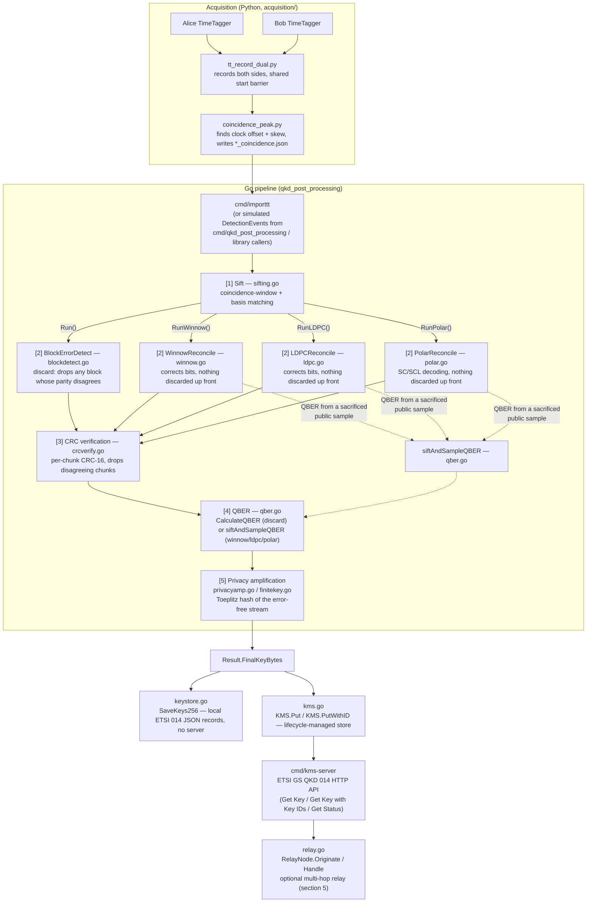
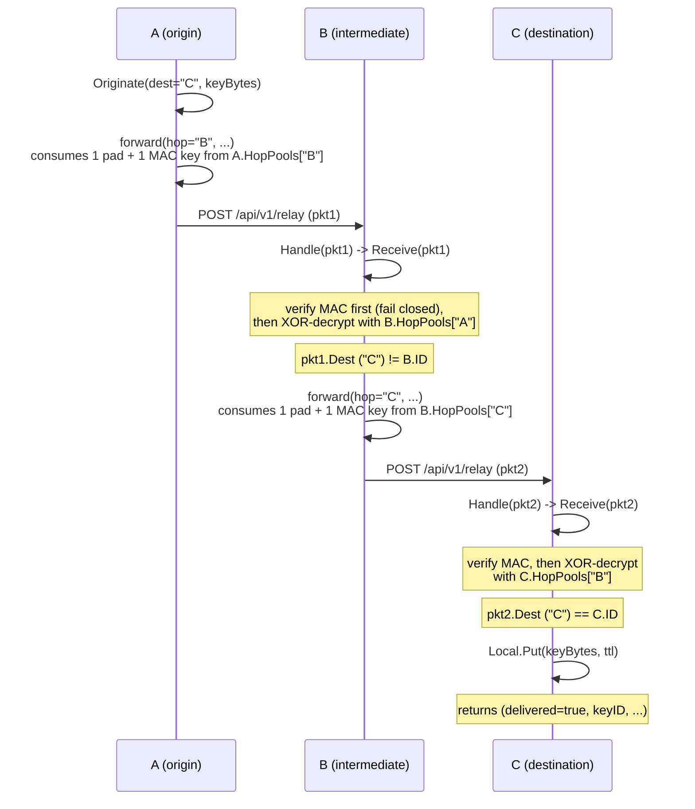
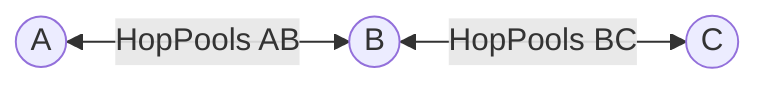

# Architecture

Scope: this document describes the structure of the codebase — module boundaries,
data flow, exported APIs, and build/deployment mechanics. It is not a security
proof. Where a module makes a cryptographic or correctness claim, this document
states that claim in one sentence and defers the justification to
`security_proof.md` (the companion document) and to `doc/finite_key_procedure.md`
(the existing formal finite-key specification this repository already
implements). Line numbers cite the source as read; they will drift as the code
changes and should be treated as a pointer, not a guarantee.

## 1. Overview

This repository implements the classical post-processing chain for a BBM92
entangled-photon QKD link, end to end: raw detector timestamps from two
TimeTaggers go in, and finite-key-sized, privacy-amplified secret key material
— stored under ETSI GS QKD 014-shaped key records and optionally relayed across
multiple network hops — comes out. The chain has five logical stages (sifting,
error reconciliation, error verification, QBER/phase-error estimation, privacy
amplification), each implemented as a Go package-level function operating on
plain `[]byte` bit arrays, composed by one of four top-level `Run*` orchestrator
functions depending on which error-reconciliation strategy is selected. A
separate key-management layer (`kms.go`, `cmd/kms-server`) and multi-hop relay
layer (`relay.go`) sit downstream of the distilled key, independent of which
reconciliation strategy produced it.

The Go library is package `qkd_post_processing` (module `qkd_post_processing`,
Go 1.24, see `go.mod`); it has one external dependency,
`golang.org/x/crypto` (for Poly1305 and HKDF). Python scripts under
`acquisition/` are a separate, loosely-coupled layer: they produce the two
`.npy`/`.json` recording files that `cmd/importtt` consumes, but the Go pipeline
never calls into Python and vice versa.

### 1.1 Top-level layout

| Path | Purpose |
|---|---|
| `*.go` (repo root) | The `qkd_post_processing` library: sifting, reconciliation, verification, QBER, privacy amplification, finite-key sizing, KMS, relay, encryption |
| `*_test.go` (repo root) | Unit, property, fuzz, and benchmark tests for the library, one file per subject plus `property_test.go`, `fuzz_test.go`, `bench_test.go`, `split_e2e_test.go` |
| `cmd/qkd_post_processing/` | CLI: runs the full chain over a simulated click stream |
| `cmd/importtt/` | CLI: runs the full chain over a real dual-TimeTagger recording |
| `cmd/tuneblock/` | CLI: sweeps step-2 generator matrices for the highest key rate on one fixed batch |
| `cmd/kms-server/` | HTTP server: ETSI GS QKD 014 key-delivery endpoints plus multi-hop relay forwarding |
| `acquisition/` | Python: records from two TimeTaggers, finds their clock offset/skew, a standalone CHSH/Bell diagnostic |
| `ui/` | Flask dashboard: run the pipeline, watch metrics, manage recordings/keystore, drive acquisition remotely |
| `docs/` | Vendor PDFs, including the post-processing review `doc/finite_key_procedure.md` responds to |
| `doc/` | This document, `security_proof.md`, and the formal procedures `finite_key_procedure.md`, `coincidence_filtering.md`, `timing_aware_reconciliation.md` |
| `scripts/` | `test.sh` (build+vet+fmt+race+cross-arch), `tune-blocksize.sh` |
| `testdata/` | `toeplitz_vectors.json`, fixed test vectors for the Toeplitz hash |
| `Dockerfile` | Single image: Go toolchain output (`qkd_post_processing`, `importtt`, `tuneblock`) plus the Python acquisition dependencies |
| `Makefile` | `build`/`test`/`test-all`/`bench`/`tune`/`run`/`vet`/`fmt`/`clean`/`check` targets |
| `go.mod` / `go.sum` | Module `qkd_post_processing`, Go 1.24, one direct dependency (`golang.org/x/crypto`) |

Three items at the repository root — `qoj_post_processing`, `qoj_post_processing.test`,
`qoj_patent_post_processing_en.md` — are pre-rename build/doc artifacts
(the module and `cmd/qoj_post_processing` were renamed to `qkd_post_processing`
/ `cmd/qkd_post_processing`, per the git history) and are not part of the
current source tree.

## 2. Data flow

Everything up to and including step 5 operates on one side's own bits plus the
peer's already-public metadata (parity bits, CRCs, syndromes); the two sides
never exchange raw key bits. `pipeline.go`, `pipeline_winnow.go`,
`pipeline_ldpc.go`, and `pipeline_polar.go` each provide a convenience orchestrator
(`Run`, `RunWinnow`, `RunLDPC`, `RunPolar`) that runs both sides together for simulation/testing; real two-site
operation uses the split, one-sided functions each stage exposes
(`ComputeBlockParity`/`ReconcileBlocks`, `ComputeChunkCRC`/`ReconcileChunks`,
etc.) so Alice and Bob can run as independent processes that never share raw
bits.

### 2.1 Selecting a reconciliation strategy

The four strategies are mutually exclusive at the CLI level and structurally
separate at the library level — there is no shared "strategy" interface; each
is its own top-level function with its own `*RunConfig` / `*RunResult` pair:

| Strategy | Entry point | Config type | Result type | CLI flag (`cmd/importtt`, `cmd/qkd_post_processing`) |
|---|---|---|---|---|
| Block discard (default) | `Run` (`pipeline.go`) | `Config` (`pipeline.go`) | `Result` (`pipeline.go`) | none (default); `-matrix bch` or `-search-matrix` picks the generator matrix |
| Winnow correction | `RunWinnow` (`pipeline_winnow.go`) | `WinnowRunConfig` (`pipeline_winnow.go`) | `WinnowRunResult` (`pipeline_winnow.go`) | `-winnow` |
| LDPC belief propagation | `RunLDPC` (`pipeline_ldpc.go`) | `LDPCRunConfig` (`pipeline_ldpc.go`) | `LDPCRunResult` (`pipeline_ldpc.go`) | `-ldpc` |
| Polar SC/SCL decoding | `RunPolar` (`pipeline_polar.go`) | `PolarRunConfig` (`pipeline_polar.go`) | `PolarRunResult` (`pipeline_polar.go`) | `-polar` |

`cmd/importtt/main.go` and `cmd/qkd_post_processing/main.go` both
enforce that `-winnow`, `-ldpc`, `-polar`, and `-search-matrix` are mutually exclusive at
flag-parsing time; `main()` then dispatches to exactly one of
`runDiscardPipeline` / `runWinnowPipeline` / `runLDPCPipeline` / `runPolarPipeline` (plus
`runEpochedPipeline` in `cmd/importtt`, discard-only). The four strategies
differ structurally, not just parametrically: discard measures QBER from the
blocks it already dropped (`CalculateQBER`, `qber.go`), while Winnow, LDPC, and polar
never discard anything up front, so they measure QBER from a separate
sacrificed public sample (`siftAndSampleQBER`, `qber.go`) taken before
reconciliation runs.

`doc/finite_key_procedure.md` section 2.3 records the formal recommendation on
which to use: LDPC as the default (tuned per-link), Winnow as a fallback where
belief propagation is judged too complex to operate, and discard only for its
original role as the simplest, most conservative baseline — its reconciliation
inefficiency is markedly worse than either corrector's.

## 3. Pipeline stages

### 3.1 Sifting (`sifting.go`, `events.go`)

Purpose: from each side's raw detector clicks, find the subset that are
basis-matched, unambiguous, single-photon coincidences — the only clicks that
can contribute key bits.

| Identifier | Signature | File |
|---|---|---|
| `DetectionEvent` | `struct { TimestampPS int64; Basis Basis; Bit byte; MultiPhoton bool }` | `events.go` |
| `Basis` | `type Basis uint8` | `events.go` |
| `PublicEvent` | `struct { TimestampPS int64; Basis Basis; MultiPhoton bool }` | `sifting.go` |
| `StripBit` | `func StripBit(events []DetectionEvent) []PublicEvent` | `sifting.go` |
| `MatchedPair` | `struct { AliceIdx, BobIdx int }` | `sifting.go` |
| `MatchCoincidences` | `func MatchCoincidences(alice, bob []PublicEvent, windowPS int64) []MatchedPair` | `sifting.go` |
| `SiftedBit` | `struct { AliceBit, BobBit byte; AliceIdx, BobIdx int }` | `sifting.go` |
| `Sift` | `func Sift(aliceEvents, bobEvents []DetectionEvent, windowPS int64) []SiftedBit` | `sifting.go` |

Inputs: two `[]DetectionEvent` (or, for the split one-sided form, two
`[]PublicEvent`, since `MatchCoincidences` never needs the measured bit,
only timestamp/basis/multi-photon-flag — that is the point of the
`PublicEvent`/`DetectionEvent` split: classical-channel-safe metadata is a
distinct type from the secret bit value). Output: `[]SiftedBit` (bit values,
for simulation) or `[]MatchedPair` (indices only, for the real two-sided
protocol). Selectable parameter: `windowPS`, the coincidence window in
picoseconds (`-window` in both CLIs). A click flagged `MultiPhoton` is excluded
from matching entirely; a timestamp with more than one basis-matched candidate
on the peer side within the window is dropped on both sides as ambiguous
(`bobCandidateCount`, `sifting.go`).

### 3.1b Coincidence filtering (`coincfilter.go`, `detdelay.go`)

Runs in `cmd/importtt` after clock alignment and before sifting (`-filter`, on by
default), specified in `doc/coincidence_filtering.md`. It prunes Bob clicks that
can never coincide, tracks the coincidence peak in 250 ms slices from public
timing only, removes its drift iteratively with linear extrapolation, and sets
the window half-width to the HWHM of a Gaussian fit to the corrected peak. On
the real recordings the window narrows from 1-10 ns to ±38-41 ps and QBER falls
from 20-43% to 5.2-9.4%. `-dir a,b,c` pools recordings into one PA block;
`-calibrate-delays` / `-detector-delays` measure and remove per-detector delays.

| Identifier | Signature | File |
|---|---|---|
| `PruneToCoincidenceRange` | `func PruneToCoincidenceRange(alice, bob []DetectionEvent, radiusPS int64) []DetectionEvent` | `coincfilter.go` |
| `DriftConfig` | `struct { SliceDurationPS, SearchRadiusPS, BinPS int64; MinScore float64 }` | `coincfilter.go` |
| `DriftModel` | `struct { TimesPS []int64; OffsetsPS []float64; Slices int }` | `coincfilter.go` |
| `EstimateDrift` | `func EstimateDrift(alice, bob []PublicEvent, cfg DriftConfig) (DriftModel, error)` | `coincfilter.go` |
| `ApplyDrift` | `func ApplyDrift(bob []DetectionEvent, m DriftModel) []DetectionEvent` | `coincfilter.go` |
| `GaussianFit` | `struct { CentrePS, SigmaPS, Amplitude, Background float64; BinPS int64 }`, method `HWHM()` | `coincfilter.go` |
| `FilterCoincidences` | `func FilterCoincidences(alice, bob []DetectionEvent, cfg DriftConfig, wc WindowConfig) ([]DetectionEvent, CoincidenceFilter, error)` | `coincfilter.go` |
| `CalibrateDetectorDelays` | `func CalibrateDetectorDelays(alice, bob []DetectionEvent, radiusPS int64) (DetectorDelays, []PairPeak, error)` | `detdelay.go` |
| `ApplyDetectorDelays` | `func ApplyDetectorDelays(events []DetectionEvent, delays [2][2]float64) []DetectionEvent` | `detdelay.go` |
| `TimingLeakBits` | `func TimingLeakBits(peaks []PairPeak) float64` | `detdelay.go` |

### 3.2 Error detection — block discard (`blockdetect.go`, `bch.go`, `matrixsearch.go`)

Purpose: detect (never correct) errors in `m`-bit blocks of the sifted key via
a shared linear generator matrix; a block whose parity disagrees is dropped
whole, both sides' copies, never patched bit by bit.

| Identifier | Signature | File |
|---|---|---|
| `GeneratorMatrix` | `type GeneratorMatrix [][]byte` | `blockdetect.go` |
| `(GeneratorMatrix) BlockSize` | `func (g GeneratorMatrix) BlockSize() int` | `blockdetect.go` |
| `(GeneratorMatrix) ParityBits` | `func (g GeneratorMatrix) ParityBits() int` | `blockdetect.go` |
| `CascadeGeneratorMatrices` | `func CascadeGeneratorMatrices(g1, g2 GeneratorMatrix) (GeneratorMatrix, error)` | `blockdetect.go` |
| `ComputeBlockParity` | `func ComputeBlockParity(bits []byte, g GeneratorMatrix) [][]byte` | `blockdetect.go` |
| `ReconcileBlocks` | `func ReconcileBlocks(ownBits []byte, ownParity, peerParity [][]byte, blockSize int) BlockReconcileResult` | `blockdetect.go` |
| `BlockErrorDetect` | `func BlockErrorDetect(alice, bob []byte, g GeneratorMatrix) BlockDetectResult` | `blockdetect.go` |
| `BCHGeneratorMatrix` | `func BCHGeneratorMatrix(gfBits, t, blockSize int) (GeneratorMatrix, error)` | `bch.go` |
| `GeneratorMatrixBCHt2` | `var GeneratorMatrixBCHt2 = mustBCHGeneratorMatrix(6, 2, 32)` | `bch.go` |
| `SearchGeneratorMatrix` | `func SearchGeneratorMatrix(m, p int, aliceEvents, bobEvents []DetectionEvent, windowPS int64, chunkSize, iterations int, seed int64) (best GeneratorMatrix, bestKeyRate float64)` | `matrixsearch.go` |

Inputs: each side's own bit array plus a shared `GeneratorMatrix` (parity bit
`i` is the XOR of the message bits `G` row `i` selects: `P = M·Gᵀ` mod 2).
Output: `BlockDetectResult` with `SurvivingAlice`/`SurvivingBob` (kept blocks,
concatenated) and `DiscardedAlice`/`DiscardedBob` (dropped blocks, fed to
`CalculateQBER`). Selectable parameters: which matrix (`-matrix bch`, the only
built-in name; `GeneratorMatrixBCHt2` is a 32-bit-block, Hamming-weight-2
guaranteed-detection BCH matrix) or `-search-matrix` (hill-climbs a matrix
directly against key rate via `SearchGeneratorMatrix`, with its own
`-search-m`/`-search-p`/`-search-iterations`/`-search-seed` and, critically,
`-search-offline-err`/`-search-offline-n` — the search must run on independent
proxy data, never the real session's own bits, or the matrix choice itself
leaks information `PrivacyAmplify` never accounts for; both CLIs enforce this
ordering automatically). `CascadeGeneratorMatrices` stacks two matrices'
rows to catch collisions invisible to either alone.

### 3.3 Error correction — Winnow (`winnow.go`, `pipeline_winnow.go`)

Purpose: correct (not merely detect) single-bit errors per block via
Hamming-code syndrome comparison, across one or more passes with different
block sizes and permutations, trading more classical-channel leakage for not
discarding correct bits alongside errors.

| Identifier | Signature | File |
|---|---|---|
| `HammingGeneratorMatrix` | `func HammingGeneratorMatrix(blockSize int) (GeneratorMatrix, error)` | `winnow.go` |
| `WinnowCorrect` | `func WinnowCorrect(ownBits []byte, g GeneratorMatrix, referenceSyndrome [][]byte) (corrected []byte, flipped int)` | `winnow.go` |
| `WinnowConfig` | `struct { BlockSizes []int; Permutations [][]int }` | `winnow.go` |
| `WinnowReconcile` | `func WinnowReconcile(alice, bob []byte, cfg WinnowConfig) (correctedBob []byte, totalLeaked, totalCorrections int)` | `winnow.go` |
| `GeneratePermutation` | `func GeneratePermutation(n int, seed int64) []int` | `winnow.go` |
| `WinnowRunConfig` | `struct { ...; WinnowBlockSizes []int; Seed int64; ChunkSize int; KeyAlignBits int }` | `pipeline_winnow.go` |
| `RunWinnow` | `func RunWinnow(aliceEvents, bobEvents []DetectionEvent, cfg WinnowRunConfig) (WinnowRunResult, error)` | `pipeline_winnow.go` |

Inputs: sifted bits remaining after a random public sample is sacrificed for
QBER (`siftAndSampleQBER`); a list of per-pass Hamming block sizes
(`-winnow-blocks`, default `"25,50,100"`) and matching permutations (derived
from `Seed`). Output: `WinnowRunResult` carrying `WinnowCorrections` (bits
flipped), `WinnowLeakedBits` (syndrome bits disclosed), and the usual
`FinalKeyBits`/`FinalKeyBytes`. Selectable parameters: `-winnow-blocks` (one
Hamming block size per pass — larger blocks correct fewer, smaller errors leak
fewer bits per pass; multiple passes with different permutations catch errors
a single pass's one-error-per-block model misses), `-winnow-sample` (fraction
of sifted bits sacrificed for the direct QBER sample, default 0.05). Winnow's
one-error-per-block model can still miss a block with two or more errors; the
subsequent CRC pass (3.5) catches most of what it misses.

### 3.4 Error correction — LDPC (`ldpc.go`, `pipeline_ldpc.go`)

Purpose: correct errors via one LDPC syndrome reveal per block, decoded by
normalized min-sum belief propagation, instead of Winnow's multi-pass
syndrome exchange.

| Identifier | Signature | File |
|---|---|---|
| `LDPCMatrix` | `struct { N, M int; Wc, Wr int; CheckVars [][]int32; ... }` | `ldpc.go` |
| `BuildRegularLDPC` | `func BuildRegularLDPC(n, wc, wr int, seed int64) (*LDPCMatrix, error)` | `ldpc.go` |
| `BuildPEGLDPC` | `func BuildPEGLDPC(n, wc, wr int, seed int64) (*LDPCMatrix, error)` | `ldpc.go` |
| `(*LDPCMatrix) Syndrome` | `func (h *LDPCMatrix) Syndrome(bits []byte) []byte` | `ldpc.go` |
| `LDPCDecodeConfig` | `struct { MaxIterations int }` | `ldpc.go` |
| `LDPCDecode` | `func LDPCDecode(h *LDPCMatrix, receivedBits, syndrome []byte, qber float64, cfg LDPCDecodeConfig) (corrected []byte, converged bool, iterations int)` | `ldpc.go` |
| `LDPCReconcile` | `func LDPCReconcile(h *LDPCMatrix, alice, bob []byte, qber float64, cfg LDPCDecodeConfig) (correctedBob []byte, convergedBlocks, totalBlocks, leakedBits int)` | `ldpc.go` |
| `LDPCRunConfig` | `struct { ...; BlockLength int; ColWeight int; RowWeight int; MaxIterations int; Seed int64; ... }` | `pipeline_ldpc.go` |
| `RunLDPC` | `func RunLDPC(aliceEvents, bobEvents []DetectionEvent, cfg LDPCRunConfig) (LDPCRunResult, error)` | `pipeline_ldpc.go` |

Inputs: same QBER-sample-then-reconcile structure as Winnow. `BuildRegularLDPC`
constructs a Gallager-style regular sparse parity-check matrix with 4-cycle
avoidance up to a cost cap (`ldpcCycleAvoidanceMaxPairs`, `ldpc.go`);
`BuildPEGLDPC` is an alternative Progressive Edge Growth construction that
directly maximizes local girth (available as a library function; not wired to
a CLI flag in either `cmd/importtt` or `cmd/qkd_post_processing`). Output:
`LDPCRunResult` carrying `LDPCBlocks`/`LDPCConverged` (syndrome satisfied
within the iteration cap) /`LDPCLeakedBits`. Selectable parameters:
`-ldpc-block` (codeword length, 0 = one block spanning the whole remaining
key), `-ldpc-wc`/`-ldpc-wr` (column/row weight; code rate is `1-wc/wr`, which
`doc/finite_key_procedure.md` 2.3 recommends tuning comfortably — not
marginally — below `1-h2(QBER)`, since a finite-degree regular code's real
decoding threshold runs below the Shannon bound), `-ldpc-iterations` (belief
propagation cap per block, 0 = default 50, `defaultLDPCMaxIterations`,
`ldpc.go`), `-ldpc-sample` (QBER sample fraction, default 0.05).

### 3.4b Error correction — polar codes (`polar.go`, `pipeline_polar.go`)

Purpose: correct errors with one disclosure per block and a single-pass,
non-iterative decoder, following Arıkan (2009) and its QKD reconciliation use in
Jouguet & Kunz-Jacques (2014), with successive-cancellation list (SCL) decoding
per Tal & Vardy (2012) and its QKD evaluation in Yan et al. (2018).

| Identifier | Signature | File |
|---|---|---|
| `PolarTransform` | `func PolarTransform(bits []byte) ([]byte, error)` | `polar.go` |
| `PolarCode` | `struct { N, K int; Frozen []bool; FrozenIdx []int }` | `polar.go` |
| `BuildPolarCode` | `func BuildPolarCode(n, k int, designQBER float64) (*PolarCode, error)` | `polar.go` |
| `PolarDecodeConfig` | `struct { ListSize int }` | `polar.go` |
| `PolarSCDecode` | `func PolarSCDecode(code *PolarCode, receivedBits, frozenVals []byte, qber float64, cfg PolarDecodeConfig) ([]byte, error)` | `polar.go` |
| `PolarPass` | `func PolarPass(code *PolarCode, alice, bob []byte, qber float64, cfg PolarDecodeConfig) (PolarReconcileResult, error)` | `polar.go` |
| `PolarReconcile` | `func PolarReconcile(code *PolarCode, alice, bob []byte, qber float64, cfg PolarDecodeConfig) (correctedBob []byte, totalBlocks, bitsCorrected, leakedBits int, err error)` | `polar.go` |
| `PolarRunConfig` | `struct { ...; BlockLength int; RateMargin float64; ListSize int; Seed int64; ... }` | `pipeline_polar.go` |
| `RunPolar` | `func RunPolar(aliceEvents, bobEvents []DetectionEvent, cfg PolarRunConfig) (PolarRunResult, error)` | `pipeline_polar.go` |

**Protocol.** Each sifted bit is modelled as passing through a binary symmetric
channel with crossover probability equal to the sampled QBER. Alice applies the
polar transform $G_N = F^{\otimes n}$, $F = \begin{psmallmatrix}1&0\\1&1\end{psmallmatrix}$
(no bit-reversal permutation, so the transform is its own inverse) to each
$N$-bit block and discloses the values at the $N-K$ least reliable positions.
Bob decodes from his own bits' channel LLRs plus those disclosed values, then
applies the same transform to recover Alice's block. Leaked bits are exactly
$N-K$ per block, the same role as LDPC's syndrome.

**Construction.** Positions are ranked by the Gaussian approximation
(Trifonov 2012), started from the LLR mean of a BI-AWGN channel whose capacity
equals the BSC's ($1-h_2(\mathrm{QBER})$). The simpler Bhattacharyya bound was
measured to give a 2.3× higher block failure rate at $N=1024$ and is not used.

**Decoding.** For $x = (T(u_1)\oplus T(u_2),\ T(u_2))$ the decoder recovers
$u_1$ from $f(L_\text{left}, L_\text{right})$, re-encodes it, then recovers
$u_2$ from $g(L_\text{left}, L_\text{right}, T(\hat u_1))$, recursively. $f$ is
the min-sum approximation and the SCL path metric is the approximate LLR form of
Balatsoukas-Stimming et al. (2015); list size 1 takes a zero-allocation
plain-SC path. Selectable parameters: `-polar-n` (block length, a power of two,
0 = largest covering the remaining key), `-polar-margin` (rate margin below
$1-h_2(\mathrm{QBER})$, default 0.1), `-polar-list` (SCL list size $L$, default 8,
1 = plain SC), `-polar-sample` (QBER sample fraction, default 0.05).

**Measured behaviour** (`polar_test.go`, `bench_test.go`; one machine, indicative):

| Check | Result |
|---|---|
| SC vs. brute-force ML decoding, $N=4$ and $N=8$, QBER 8% | success 0.853 vs 0.850, 0.897 vs 0.895 |
| Reliability ordering vs. measured genie error rate, $N=64$ | Spearman $\rho = 0.987$ |
| Block failure, $N=1024$, QBER 3%, rate 0.656 | SC 9.8%, SCL ($L=16$) 2.4% |
| Decode time, $2^{20}$ bits, QBER 3%, rate 0.7 | LDPC 0.30 s, polar SC 0.13 s, polar SCL ($L=8$) 1.13 s |

**Tradeoff, stated plainly.** Plain SC is faster than this codebase's LDPC
decoder and has no non-convergence mode, but at short-to-moderate $N$ it fails
more blocks than its rate suggests; SCL closes much of that gap at roughly $L$
times SC's cost. A failed block is not silently accepted: it leaves residual
errors that the CRC stage (3.5) drops. Systematic encoding and CRC-aided list
decoding, both used in the literature, are not implemented.

### 3.4c Timing-aware soft reconciliation (`softrecon.go`)

An option on the LDPC and polar strategies (`TimingBins` in `LDPCRunConfig` /
`PolarRunConfig`, CLI `-soft-bins`), specified formally in
`doc/timing_aware_reconciliation.md`. Each sifted bit's public arrival-time
offset $\Delta t$ selects its own error rate $q(\Delta t)$, estimated per bin from
the sacrificed QBER sample, and the decoder starts from per-bit LLRs instead of
one flat QBER. By Jensen's inequality the disclosure bound can only fall. LDPC
discloses the same syndrome and converges more blocks; polar also builds each
block's code and rate from its bits' $q_i$, so it discloses less. Privacy
amplification is unchanged.

| Identifier | Signature | File |
|---|---|---|
| `TimingErrorModel` | `struct { WindowPS int64; ErrorRate []float64; Counts, Errors []int }` | `softrecon.go` |
| `EstimateTimingErrorModel` | `func EstimateTimingErrorModel(sampleAlice, sampleBob []byte, sampleDt []int64, windowPS int64, bins int) (TimingErrorModel, error)` | `softrecon.go` |
| `SoftLLRs` | `func SoftLLRs(receivedBits []byte, q []float64) []float64` | `softrecon.go` |
| `SlepianWolfBounds` | `func SlepianWolfBounds(q []float64) (soft, flat float64)` | `softrecon.go` |
| `PolarReconcileSoft` | `func PolarReconcileSoft(alice, bob []byte, q []float64, blockLength int, margin float64, cfg PolarDecodeConfig) (...)` | `softrecon.go` |
| `LDPCReconcileSoft` | `func LDPCReconcileSoft(h *LDPCMatrix, alice, bob []byte, q []float64, cfg LDPCDecodeConfig) (...)` | `softrecon.go` |
| `TimingReport` | `struct { Model TimingErrorModel; SoftBound, FlatBound float64 }` | `softrecon.go` |

### 3.5 Error verification (`crcverify.go`)

Purpose: a cheap, fast second check over the EC-surviving stream, to catch
what step 2/3's own correction missed (a block whose decode converged to the
wrong codeword, a two-error Winnow block, etc.).

| Identifier | Signature | File |
|---|---|---|
| `CRCVerifyResult` | `struct { SurvivingAlice, SurvivingBob, DiscardedAlice, DiscardedBob []byte; ChunksTotal, ChunksKept, ChunksDropped, LeakedBits int }` | `crcverify.go` |
| `ComputeChunkCRC` | `func ComputeChunkCRC(bits []byte, chunkSize int) []uint16` | `crcverify.go` |
| `ReconcileChunks` | `func ReconcileChunks(ownBits []byte, ownCRC, peerCRC []uint16, chunkSize int) ChunkReconcileResult` | `crcverify.go` |
| `CRCVerify` | `func CRCVerify(alice, bob []byte, chunkSize int) CRCVerifyResult` | `crcverify.go` |

Inputs: the EC-surviving bit stream, plus `chunkSize` in bits (`-chunk`).
Algorithm: CRC-16/CCITT-FALSE (`crc16Poly = 0x1021`, `crcverify.go`) computed
per chunk, 16 bits leaked per surviving chunk. Selectable parameter: `-chunk`
— discard's default is 2048 bits; Winnow/LDPC need a much smaller value (the
CLIs' help text suggests ~128) since without an upfront discard step, a large
CRC chunk containing even one residual error discards far more good bits per
catch. Claim (one sentence; see `doc/finite_key_procedure.md` section 2.4 and
`security_proof.md` for the justification): CRC-16 alone bounds correctness
only to about `2⁻¹⁶`, which is why `universalhash.go` (section 6) exists as a
stronger check immediately before privacy amplification.

### 3.6 QBER estimation (`qber.go`)

Purpose: produce the single error-rate number that privacy amplification's
Devetak-Winter / finite-key rate formula consumes.

| Identifier | Signature | File |
|---|---|---|
| `QBERResult` | `struct { ErrorBits, SampleBits int; QBER float64 }` | `qber.go` |
| `siftAndSampleQBER` (unexported) | `func siftAndSampleQBER(aliceEvents, bobEvents []DetectionEvent, windowPS int64, sampleFraction float64, seed int64) (siftedBits int, aliceRem, bobRem []byte, qber QBERResult)` | `qber.go` |
| `CalculateQBER` | `func CalculateQBER(discardedAliceBlocks, discardedBobBlocks []byte, siftedBits int) QBERResult` | `qber.go` |

Two distinct estimators, one per reconciliation family: `CalculateQBER` (used
by `Run`) reads the error rate off the blocks block-discard already dropped,
over the whole sifted key; `siftAndSampleQBER` (used by `RunWinnow`/`RunLDPC`)
measures a direct, unbiased rate from a random public sample taken before
reconciliation runs, since the residual error rate after correction is exactly
what correction just tried to drive to zero and so cannot be used to estimate
its own input error rate.

### 3.7 Privacy amplification (`privacyamp.go`, `toeplitz.go`, `toeplitz_clmul_amd64.go`, `finitekey.go`)

Purpose: compress the error-free, verified bit stream down to a length short
enough that an eavesdropper's information about it is negligible, via a
two-universal (Toeplitz) hash family.

| Identifier | Signature | File |
|---|---|---|
| `SecureKeyLength` | `func SecureKeyLength(n int, qber float64, leakedBits int) int` | `privacyamp.go` |
| `PrivacyAmplify` | `func PrivacyAmplify(errorFreeBits []byte, qber float64, leakedBits, alignBits int) (key []byte, seed []byte, err error)` | `privacyamp.go` |
| `toeplitzHashFast` (unexported) | `func toeplitzHashFast(x []byte, seed []byte, l int) []byte` | `toeplitz.go` |
| `toeplitzSeed` (unexported) | `func toeplitzSeed(l, n int) ([]byte, error)` | `toeplitz.go` |
| `FiniteKeySecureKeyLength` | `func FiniteKeySecureKeyLength(n int, phi float64, leakedBits int, epsCor, epsPA float64) int` | `finitekey.go` |
| `FiniteKeyConfig` | `struct { EpsSec, EpsCor float64 }` | `finitekey.go` |
| `FiniteKeyReport` | `struct { PhiPoint, Phi float64; TagBits int; Verified bool; LeakedBits, Length int }` | `finitekey.go` |

Two accounting modes, chosen per run:

- **Finite-key (default for Winnow, LDPC and polar).** `distillFiniteKey`
  bounds the phase error of the kept bits across bases (key bits of each basis
  from the other basis's sample errors, plus the fluctuation term at
  $\varepsilon_\text{PE}/2$, scaled up for CRC-dropped chunks), verifies the two
  surviving strings with a $\log_2(1/\varepsilon_\text{cor})$-bit universal hash
  (no key on mismatch), and hashes to `FiniteKeySecureKeyLength`'s length. CLI:
  `-eps-sec` (default $10^{-10}$), `-eps-cor` (default $10^{-15}$).
- **Asymptotic** (`-asymptotic`, and always for block discard, which has no
  random sample): `SecureKeyLength` = $n(1 - h_2(\mathrm{QBER}))$ minus the bits
  actually disclosed. The earlier form $n(1 - 2h_2)$ minus disclosure charged
  error correction twice and was corrected.

A phase-error bound at or above $\tfrac12$ yields no key in both modes; the
earlier clamp at 1 would have certified the whole block, since $h_2(1) = 0$.
`toeplitzHashFast` dispatches to a hardware-CLMUL implementation
(`toeplitzHashCLMUL`, `toeplitz_clmul_amd64.go`) on amd64 CPUs that support
`PCLMULQDQ`, falling back to a POPCNT-based implementation
(`toeplitzHashPopcount`, `toeplitz.go`) elsewhere; both compute the same
function, verified against each other and against a reference `O(l·n)`
implementation (`toeplitzHashNaive`, `toeplitz.go`, test-only) in
`toeplitz_test.go`/`toeplitz_vectors_test.go`. Selectable parameter:
`alignBits` / `-keystore` implies `KeyAlignBits = ETSI014KeySizeBits`
(256) so a caller chunking the key into fixed-size records afterward never
discards a partial-record remainder.

### 3.8 Window and epoch reporting (`windowreport.go`, `epoch.go`)

Purpose: two read-only / structural diagnostics layered on top of the chain
above, neither of which feeds back into which bits become key material except
as noted.

| Identifier | Signature | File |
|---|---|---|
| `WindowReportConfig` | `struct { BucketPS int64; MinPairs int }` | `windowreport.go` |
| `WindowBucketReport` | `struct { StartPS int64; PairCount int; QBER float64; Reportable bool }` | `windowreport.go` |
| `ReportWindowQuality` | `func ReportWindowQuality(aliceEv, bobEv []DetectionEvent, pairs []MatchedPair, cfg WindowReportConfig) []WindowBucketReport` | `windowreport.go` |
| `EpochResult` | `struct { StartPS int64; Result }` | `epoch.go` |
| `EpochedResult` | `struct { Epochs []EpochResult; FinalKeyBits, FinalKeyBytes []byte }` | `epoch.go` |
| `RunEpoched` | `func RunEpoched(aliceEvents, bobEvents []DetectionEvent, cfg Config, epochPS int64) (EpochedResult, error)` | `epoch.go` |

`ReportWindowQuality` (`cmd/importtt -window-report`) buckets already-sifted
pairs by elapsed time and reports each bucket's own QBER — diagnostic only; it
never selects which bits become key, precisely because doing so after seeing
per-bucket QBER would be the kind of post-selection bias
`doc/finite_key_procedure.md` section 2.5 and `EstimatePhaseError`'s
`conservative` parameter exist to guard against. `RunEpoched`
(`cmd/importtt -epoch-s`) is structural, not diagnostic: it reruns the entire
discard-only `Run` chain independently once per fixed time epoch instead of
pooling a whole recording into one QBER estimate, so a noisy epoch contributes
zero key bits on its own account rather than being silently averaged in or
excluded after the fact. It is wired to the block-discard path only —
`cmd/importtt` refuses `-epoch-s` together with `-winnow`/`-ldpc`/`-search-matrix`
(`cmd/importtt/main.go`).

## 4. Key management (KMS)

### 4.1 Data model (`kms.go`)

`KMS` is one site's on-disk key store: one JSON file per `key_ID` under a
directory, encrypted at rest.

| Identifier | Signature / shape | File |
|---|---|---|
| `kmsRecord` (unexported) | `struct { KeyID string; Ciphertext string; CreatedAt, ExpiresAt time.Time; Consumed bool; ConsumedAt time.Time }` | `kms.go` |
| `KMS` | `struct { dir string; masterKey []byte; mu sync.Mutex }` | `kms.go` |
| `NewKMS` | `func NewKMS(dir string, masterKey []byte) (*KMS, error)` | `kms.go` |
| `(*KMS) Put` | `func (k *KMS) Put(keyBytes []byte, ttl time.Duration) (keyID string, err error)` | `kms.go` |
| `(*KMS) PutWithID` | `func (k *KMS) PutWithID(keyID string, keyBytes []byte, ttl time.Duration) error` | `kms.go` |
| `(*KMS) Get` | `func (k *KMS) Get(keyID string) ([]byte, error)` | `kms.go` |
| `DeliveredKey` | `struct { KeyID string; Key []byte }` | `kms.go` |
| `(*KMS) GetNext` | `func (k *KMS) GetNext(n int) ([]DeliveredKey, error)` | `kms.go` |
| `(*KMS) GetNextBytes` | `func (k *KMS) GetNextBytes(n int) ([]byte, []string, error)` | `kms.go` |
| `(*KMS) GetBytes` | `func (k *KMS) GetBytes(ids []string, n int) ([]byte, error)` | `kms.go` |
| `Status` | `struct { StoredKeyCount, ConsumedKeyCount, ExpiredKeyCount int }` | `kms.go` |
| `(*KMS) Status` | `func (k *KMS) Status() (Status, error)` | `kms.go` |

`Ciphertext` is `EncryptWithKey`'s AES-256-GCM output under the KMS's own
32-byte `masterKey` (operator-provisioned, not QKD-derived — losing it loses
every stored key, per `kms.go`'s doc comment). Record files are written
`0o600`, the containing directory `0o700` (`NewKMS`, `kms.go`). Single-delivery
semantics: `Get` marks a record `Consumed` on its first successful call
(`kms.go`) and returns `ErrKeyConsumed` (`kms.go`) on any subsequent
call for the same `key_ID`; `ErrKeyExpired` (`kms.go`) is returned once
`time.Now()` passes `ExpiresAt`. `Put` mints a fresh UUIDv4 `key_ID`
(`newKeyID`, `keystore.go`) for the "master" side that computed the key
first; `PutWithID` lets the peer ("slave") store the same, already
bit-identical bytes under that same `key_ID`, refusing if the ID already
exists (`kms.go`) so one ID can never map to two different keys.
`GetNextBytes`/`GetBytes` concatenate whole pool keys via repeated
`GetNext(1)` calls until `n` bytes are collected, returning the ordered list
of `key_ID`s consumed alongside the bytes — this is the primitive section 5's
relay layer uses to draw a pad or MAC key of an arbitrary byte length from a
pool of fixed-size QKD-derived keys. One claim (see `security_proof.md` for
justification): `KMS` enforces that no two callers can ever receive the same
key material, which is the delivery-side precondition any one-time-pad or
MAC usage of that material depends on.

Concurrency/deployment limitation stated in `kms.go`'s own doc comment,
reproduced here for completeness: `KMS` is a single-writer-per-directory
store; cross-process concurrent access to the same directory is not its
supported model.

### 4.2 `cmd/kms-server` HTTP API

`cmd/kms-server/main.go` implements the subset of ETSI GS QKD 014 this
project targets, one master/slave SAE pair per KMS instance, plus the multi-hop
relay endpoints of `cmd/kms-server/relay.go` when `-node-id` is set.

| Route | Method | Request | Response | Handler |
|---|---|---|---|---|
| `/api/v1/keys/{slave_sae_id}/enc_keys` | GET | query param `number` (optional, default `-default-count`) | `etsiKeyContainer{Keys: []etsiKey{KeyID, Key (base64)}}` | `handleEncKeys`, `main.go` |
| `/api/v1/keys/{master_sae_id}/dec_keys` | POST | `etsiKeyIDsRequest{KeyIDs: []{KeyID}}` | `etsiKeyContainer` (same shape) | `handleDecKeys`, `main.go` |
| `/api/v1/keys/{slave_sae_id}/status` | GET | — | `{source_KME_ID, target_KME_ID, master_SAE_ID, slave_SAE_ID, key_size, stored_key_count, consumed_key_count, expired_key_count, max_key_per_request}` | `handleStatus`, `main.go` |
| `/api/v1/relay` | POST | `RelayedPacket` (JSON) from a neighbor | `relayResult{status, dest, key_ID}`, the destination's answer passed back | `handleRelay`, `relay.go` |
| `/api/v1/relay/originate/{dest_node_id}` | POST | `{"key_bytes": base64}` from the local application | `relayResult`, with the destination's `key_ID` | `handleOriginate`, `relay.go` |

`handleEncKeys` is ETSI 014's "Get Key": it calls `KMS.GetNext(n)` and returns
up to `n` keys, fewer if the pool is short (not an error). `handleDecKeys` is
"Get Key with Key IDs": it calls `KMS.Get(id)` once per requested ID, erroring
the whole request on the first missing/consumed/expired one. `handleStatus"
wraps `KMS.Status()`. All three mint no new state beyond what `kms.go` already
tracks. Startup flags: `-dir`/`-master-key-file` (required; `-generate-master-key
<path>` writes a fresh random 32-byte base64 key and exits), `-listen`
(default `:8443`), `-tls-cert`/`-tls-key` (plain HTTP if omitted — logged as a
`[WARN]`, development only), `-tls-ca` (mutual TLS: the server demands and
verifies client certificates signed by this CA, and relay peers are verified
against it; TLS 1.3), `-default-count`, `-source-kme-id`/`-target-kme-id`/
`-master-sae-id`/`-slave-sae-id` (reported in `/status`). Relay flags:
`-node-id`, `-relay-routes` (`dest=next_hop,...`), `-relay-peers`
(`node=url,...`) and `-relay-pools` (`node=dir,...`, each a KMS directory holding
that link's QKD key pool); relayed keys are delivered into the main store, so
applications fetch them through the ETSI 014 endpoints. Tested end to end over
HTTP and over mutual TLS, including refusal of a client without a certificate
(`cmd/kms-server/relay_test.go`).

## 5. Multi-hop relay (`relay.go`)

Purpose: move already-distilled key material from the node that produced it to
a non-adjacent destination node, hop by hop, re-encrypting and re-authenticating
at every hop with fresh, QKD-derived, single-use key material — so an
intermediate hop never needs to see the key material.

| Identifier | Signature | File |
|---|---|---|
| `RelayXOR` | `func RelayXOR(payload, pad []byte) ([]byte, error)` | `relay.go` |
| `RelayNode` | `struct { ID string; Local *KMS; HopPools map[string]*KMS; NextHop map[string]string }` | `relay.go` |
| `NewRelayNode` | `func NewRelayNode(id string, local *KMS, hopPools map[string]*KMS, routes map[string]string) *RelayNode` | `relay.go` |
| `RelayedPacket` | `struct { Dest, FromHop string; PadKeyIDs, MACKeyIDs []string; Cipher, Tag []byte }` | `relay.go` |
| `(*RelayNode) Originate` | `func (n *RelayNode) Originate(dest string, keyBytes []byte) (RelayedPacket, error)` | `relay.go` |
| `forward` (unexported) | `func (n *RelayNode) forward(hop, dest string, keyBytes []byte) (RelayedPacket, error)` | `relay.go` |
| `(*RelayNode) Receive` | `func (n *RelayNode) Receive(pkt RelayedPacket) ([]byte, error)` | `relay.go` |
| `(*RelayNode) Handle` | `func (n *RelayNode) Handle(pkt RelayedPacket) (delivered bool, keyID string, next RelayedPacket, err error)` | `relay.go` |

`RelayNode` holds one `*KMS` per neighboring link (`HopPools`, each pool being
that link's own QKD output, already delivered and sitting in its own `KMS`
store) plus a destination-to-next-hop routing table (`NextHop`). `RelayedPacket`
never carries key material directly, only `key_ID` references into the
relevant hop's `KMS` pool (`PadKeyIDs`, `MACKeyIDs`) plus the ciphertext and
MAC tag — so capturing a packet in flight reveals nothing without also
compromising that specific hop's `KMS`.

### 5.1 Per-hop cryptographic draw

Each hop draws exactly two disjoint pieces of key material from the
destination-hop's `KMS` pool, both via `GetNextBytes` (`kms.go`), both
single-use:

- a one-time pad, length equal to the payload (`forward`, `relay.go`),
  consumed by `RelayXOR` (`relay.go`) — **secrecy** claim (one sentence; see
  `security_proof.md` for justification): XOR under a uniform, single-use,
  QKD-derived pad hides the plaintext from anyone without that specific pad.
- a 32-byte Poly1305 key (`PolyMACKeyBytes`, `polymac.go`), consumed by
  `ComputePolyMAC` (`polymac.go`) over `macMessage` (`relay.go` — the
  length-prefixed encoding of `dest`, `fromHop`, `PadKeyIDs`, and the
  ciphertext, i.e. everything an attacker could tamper with, not just the
  ciphertext bytes alone) — **authenticity** claim (one sentence; see
  `security_proof.md`): a single-use, QKD-derived Poly1305 key gives
  information-theoretic authentication of that one message, detecting any
  tampering with the ciphertext or its routing metadata in transit.

Since the pad and MAC key are drawn from the same `HopPools[hop]` pool but as
two separate `GetNextBytes` calls, `KMS`'s single-delivery enforcement
(section 4.1) is exactly what guarantees they are disjoint, never-reused key
material — the relay layer's security properties are built directly on the
KMS layer's delivery guarantee, not independent of it.

### 5.2 Call sequence across a multi-hop path

`Originate` (`relay.go`) is the only entry point an application calls
directly; it looks up the first hop from `NextHop[dest]` and calls `forward`.
`Handle` (`relay.go`) is what every receiving node calls on an inbound
`RelayedPacket`: it always calls `Receive` first — which verifies the MAC
before touching the ciphertext at all, fail-closed (`relay.go`'s
comment: an invalid tag is refused, never decrypted) — then either delivers
locally via `Local.Put` (if `pkt.Dest == n.ID`) or re-`forward`s toward the
next hop. Each hop re-encrypts and re-authenticates from scratch with that
hop's own fresh key draw; no ciphertext or tag survives past the node that
produced it. At the HTTP layer (`cmd/kms-server/relay.go`), `handleOriginate`
and `handleRelay` drive this sequence over the network (section 4.2).

## 6. Finite-key sizing (`finitekey.go`)

`finitekey.go` is the non-asymptotic replacement for `SecureKeyLength`
(`privacyamp.go`); `doc/finite_key_procedure.md` is the authoritative,
formal procedure this module implements — this section describes the Go API
surface only, not the derivation. Do not treat anything below as re-deriving
or superseding that document or `security_proof.md`.

| Identifier | Signature | File | Operational meaning of its parameters |
|---|---|---|---|
| `PhaseErrorEstimate` | `struct { Mu, Phi float64; Conservative bool }` | `finitekey.go` | `Mu`: the statistical fluctuation term; `Phi`: the phase-error bound to feed into `FiniteKeySecureKeyLength`; `Conservative`: whether the post-selection-bias correction (below) was applied |
| `EstimatePhaseError` | `func EstimatePhaseError(q float64, ns, k int, epsPE float64, nSifted, nSurvivingEC int, conservative bool) PhaseErrorEstimate` | `finitekey.go` | `q`: measured error rate in the sacrificed **conjugate-basis** sample (not the same-basis error rate already being corrected); `ns`: same-basis block size; `k`: conjugate-basis sample size; `epsPE`: parameter-estimation confidence; `nSifted`/`nSurvivingEC`: used only when `conservative=true`, to scale `Phi` by how much of the sifted key survived error correction |
| `FiniteKeySecureKeyLength` | `func FiniteKeySecureKeyLength(n int, phi float64, leakedBits int, epsCor, epsPA float64) int` | `finitekey.go` | `n`: EC-surviving, verified bit count going into this PA block; `phi`: `EstimatePhaseError`'s output, a dedicated phase-error bound (not same-basis QBER); `leakedBits`: total classical disclosure already charged against this block (parity/syndrome bits, CRC bits, universal-hash tag bits); `epsCor`/`epsPA`: the two independent per-block security parameters |
| `SecurityBudget` | `struct { EpsPE, EpsPA, EpsCor float64 }` | `finitekey.go` | the three composable security parameters this procedure tracks per PA block |
| `SplitSecurityBudget` | `func SplitSecurityBudget(epsSec, epsCor float64) SecurityBudget` | `finitekey.go` | splits a target total secrecy failure probability `epsSec` into `EpsPE`/`EpsPA` (each `epsSec/3`) while keeping correctness (`epsCor`) tracked separately, per the procedure's own composition convention |

Use `conservative=true` in `EstimatePhaseError` unless and until bit and phase
errors have been confirmed independent for the specific detector/source pair
in use — this is an explicit open item in `doc/finite_key_procedure.md`
section 2.5, not something either this module or this document resolves on
its own. See `doc/finite_key_procedure.md` for the full procedure, including
recommended parameter values, PA block-size guidance, and the universal-hash
correctness check (`universalhash.go`, used ahead of this stage — see section
3.5's forward reference) that this finite-key accounting depends on.

## 7. Build, test, and deployment

### 7.1 Makefile targets (`Makefile`)

| Target | Command | Purpose |
|---|---|---|
| `build` | `go build ./...` | compile everything |
| `test` | `go test ./... -v` | run the Go test suite |
| `test-all` | `./scripts/test.sh` | build+vet+fmt+race tests+cross-arch build |
| `bench` | `go test -run '^$' -bench . -benchmem ./...` | run benchmarks only |
| `tune` | `./scripts/tune-blocksize.sh` | sweep step-2 block size for the highest key rate |
| `run` | `go run ./cmd/qkd_post_processing -n 300000 -err 0.005 -chunk 3000` | demo run with sane defaults |
| `vet` | `go vet ./...` | static analysis |
| `fmt` | `gofmt -l .` (fails if anything unformatted) | formatting check |
| `clean` | `rm -f qkd_post_processing; go clean` | remove build artifacts |
| `check` | `fmt vet build test run` | everything in one shot |

### 7.2 The three CLI binaries

| Binary | Source | Invocation (minimal) | What it does |
|---|---|---|---|
| `qkd_post_processing` | `cmd/qkd_post_processing/main.go` | `go run ./cmd/qkd_post_processing -n 300000 -err 0.005 -chunk 3000` | simulates correlated Alice/Bob click streams (`simulate`, `main.go`) and runs the full chain; `-json` prints a machine-readable report instead of the human-readable one |
| `importtt` | `cmd/importtt/main.go` | `go run ./cmd/importtt -dir acquisition/<recording dir>` | loads a real dual-TimeTagger recording (via `cmd/importtt/npy.go`'s `loadNpyInt64`/`loadNpyInt8`), aligns clocks using `coincidence_peak.py`'s fitted lag+skew, maps detector channels to BBM92 (basis, bit) pairs (`channelToBasisBit`, `main.go`), then runs the same chain plus acquisition-specific diagnostics (visibility, per-channel delay, window report, per-epoch mode) |
| `tuneblock` | `cmd/tuneblock/main.go` | `go run ./cmd/tuneblock` | runs `Run` once per candidate generator matrix (currently just `bch`, plus an optional `-search`ed matrix) over one fixed simulated batch, and reports whichever yields the highest key rate |

### 7.3 Docker (`Dockerfile`)

One image, `python:3.12-slim` base, Go 1.24 toolchain installed at build time
only to produce three prebuilt binaries (`qkd_post_processing`, `importtt`,
`tuneblock`) under `/usr/local/bin`; the Python acquisition dependencies
(`acquisition/requirements.txt`) are installed via `pip`. No server process —
`CMD ["bash"]` — commands are run via `docker run --rm qkd-post-processing
<binary> <args>`, mounting `acquisition/` when a command needs to read or
write a recording. The dashboard (`ui/`) is a separate deployment, its own
`Dockerfile`/`docker-compose.yml`/Caddy reverse proxy (`ui/deploy.md`).

### 7.4 UI dashboard (`ui/app.py`, `ui/Caddyfile`, `ui/deploy.md`)

`ui/app.py` is a Flask application (`app = Flask(__name__)`, `ui/app.py`)
exposing JSON endpoints under `/api/*` — `status`, `run` (invokes the Go
binaries as subprocesses), `upload`/`recordings` (manage recording files),
`config` (read/write `acquisition/config.json`), `acquire/start|stop|status`
(drive `tt_record_dual.py` as a background process), `align/live|run` (drive
`coincidence_peak.py` and `cmd/importtt`), and `chsh/run|download` (drive
`chsh_diagnostic.py`) — plus a single HTML page served at `/`. It is meant to
run on the lab's own network (`ui/deploy.md`'s stated rationale: it needs to
reach the TimeTaggers directly, and it writes real distilled key material to
disk), fronted by Caddy (`ui/Caddyfile`) for TLS termination via
`docker compose up` (`ui/docker-compose.yml`). Deployment configuration is
either environment variables (`UPLOAD_MAX_MB`, `KEYSTORE_MAX`,
`RECORDINGS_MAX_GB`, `KEYSTORE_DIR`/`RECORDINGS_DIR`/`CONFIG_DIR`) or
`ui/config/config.json` (the same shape `acquisition/config.example.json`
documents).

### 7.5 Acquisition scripts feeding the Go pipeline (`acquisition/*.py`)

Three Python scripts, run in sequence, bridge real hardware to `cmd/importtt`:

1. `tt_stream_external.py` — vendor-provided TimeTagger network client
   (`TimeTaggerStream`: `connect`/`start_stream`/`read_stream`), included as
   provided.
2. `tt_record_dual.py` — connects to two TimeTaggers (configured in
   `acquisition/config.json`), starts both recording behind one
   `threading.Barrier` so the two capture windows begin at the same instant,
   and writes per-side `*_timestamp_sequence.npy` (int64 picoseconds) +
   `*_channel_sequence.npy` (int8 physical channel, 1-4) + `*_meta.json`. It
   also runs a lower-fidelity live coincidence check in the background
   (`live_coincidence_thread`) purely as an operator-facing progress signal.
3. `coincidence_peak.py` — the computational core of alignment: FFT
   cross-correlation for a coarse lag estimate, exact-timestamp-difference
   refinement for picosecond precision, and a segmented linear fit for clock
   skew (drift). Writes `<dir>_coincidence.json`, which records the fitted
   affine clock model (`ClockSkew.ReferenceElapsedPS`/`LagAtReferencePS`/
   `SkewFraction`) that `cmd/importtt` inverts (`toAliceClock`,
   `cmd/importtt/main.go`) to map every Bob timestamp onto Alice's clock
   before sifting. `cmd/importtt` refuses to run against a report whose
   `"detected"` field is `false` (`findRecording`, `cmd/importtt/main.go`).

`chsh_diagnostic.py` is a separate, standalone diagnostic (CHSH/Bell
self-testing statistics) over the same aligned recording; it is not part of
the key-generation chain and its output does not feed `cmd/importtt`.

## 8. File-by-file reference

### 8.1 Library (repo root)

| Path | Purpose | Key exported identifiers |
|---|---|---|
| `events.go` | Core event/basis types | `Basis`, `DetectionEvent` |
| `coincfilter.go` | Pruning, drift tracking and Gaussian-fit HWHM window from public timing | `PruneToCoincidenceRange`, `DriftConfig`, `DriftModel`, `EstimateDrift`, `ApplyDrift`, `PeakProfile`, `GaussianFit`, `WindowConfig`, `CoincidenceFilter`, `FilterCoincidences` |
| `detdelay.go` | Per-detector delay calibration and timing-leak estimate | `DetectorDelays`, `PairPeak`, `CalibrateDetectorDelays`, `ApplyDetectorDelays`, `TimingLeakBits` |
| `sifting.go` | Coincidence-window + basis sifting | `SiftedBit`, `PublicEvent`, `StripBit`, `MatchedPair`, `MatchCoincidences`, `Sift` |
| `blockdetect.go` | Block parity error detection (discard strategy) | `GeneratorMatrix`, `CascadeGeneratorMatrices`, `ComputeBlockParity`, `BlockReconcileResult`, `ReconcileBlocks`, `BlockDetectResult`, `BlockErrorDetect` |
| `bch.go` | BCH generator matrix construction | `BCHGeneratorMatrix`, `GeneratorMatrixBCHt2` |
| `matrixsearch.go` | Hill-climbed generator matrix search | `SearchGeneratorMatrix` |
| `winnow.go` | Winnow single-error correction primitives | `HammingGeneratorMatrix`, `WinnowCorrect`, `WinnowPassResult`, `WinnowPass`, `WinnowConfig`, `WinnowReconcile`, `GeneratePermutation` |
| `pipeline_winnow.go` | Winnow orchestrator | `WinnowRunConfig`, `WinnowRunResult`, `RunWinnow` |
| `ldpc.go` | LDPC matrix construction + min-sum decoder | `LDPCMatrix`, `BuildRegularLDPC`, `BuildPEGLDPC`, `(*LDPCMatrix).Syndrome`, `LDPCDecodeConfig`, `LDPCDecode`, `LDPCReconcileResult`, `LDPCPass`, `LDPCReconcile` |
| `pipeline_ldpc.go` | LDPC orchestrator | `LDPCRunConfig`, `LDPCRunResult`, `RunLDPC` |
| `polar.go` | Polar transform, Gaussian-approximation construction, SC/SCL decoder | `PolarTransform`, `PolarCode`, `BuildPolarCode`, `PolarDecodeConfig`, `PolarSCDecode`, `PolarReconcileResult`, `PolarPass`, `PolarReconcile` |
| `pipeline_polar.go` | Polar orchestrator | `PolarRunConfig`, `PolarRunResult`, `RunPolar` |
| `softrecon.go` | Timing-aware soft reconciliation for LDPC and polar | `TimingErrorModel`, `EstimateTimingErrorModel`, `SoftLLRs`, `SlepianWolfBounds`, `PolarReconcileSoft`, `LDPCReconcileSoft`, `TimingReport` |
| `crcverify.go` | CRC-16 chunk verification | `CRCVerifyResult`, `ComputeChunkCRC`, `ChunkReconcileResult`, `ReconcileChunks`, `CRCVerify` |
| `qber.go` | QBER estimation (both estimator families) | `QBERResult`, `CalculateQBER` |
| `privacyamp.go` | Asymptotic privacy amplification | `SecureKeyLength`, `PrivacyAmplify` |
| `toeplitz.go` | Toeplitz hash (POPCNT path), bit-packing helpers | (mostly unexported; `toeplitzHashFast`, `toeplitzSeed` are the stable internal entry points) |
| `toeplitz_clmul_amd64.go` | Toeplitz hash, hardware CLMUL path (amd64) | (unexported; registered into `toeplitzImpl` via `init()`) |
| `toeplitz_clmul_amd64.s` | PCLMULQDQ/CPUID assembly backing the above | `clmul64`, `hasCLMUL` (Go-declared, asm-defined) |
| `finitekey.go` | Finite-key sizing: exact hypergeometric phase-error bound, sample optimizer, distillation | `PhaseErrorEstimate`, `EstimatePhaseError`, `HypergeomUpperRate`, `OptimalSampleFraction`, `FiniteKeySecureKeyLength`, `SecurityBudget`, `SplitSecurityBudget`, `FiniteKeyConfig`, `FiniteKeyReport` |
| `universalhash.go` | Toeplitz-based universal-hash correctness check | `UniversalHashTagBits`, `ComputeUniversalHashTag`, `UniversalHashSeed`, `VerifyUniversalHash` |
| `pipeline.go` | Block-discard orchestrator (the original `Run`) | `Config`, `Result`, `Run` |
| `epoch.go` | Per-time-epoch independent reruns of `Run` | `EpochResult`, `EpochedResult`, `RunEpoched` |
| `windowreport.go` | Diagnostic per-time-bucket QBER reporting | `WindowReportConfig`, `WindowBucketReport`, `ReportWindowQuality` |
| `encryption.go` | AEAD encrypt/decrypt with a distilled key | `EncryptWithKey`, `DecryptWithKey` |
| `keystore.go` | Local ETSI 014 key container JSON files, no server | `StoredKey`, `ETSI014KeySizeBytes`, `ETSI014KeySizeBits`, `SaveKeys256`, `SaveKey`, `LoadKey` |
| `kms.go` | Lifecycle-managed key store (single delivery, TTL, at-rest encryption) | `ErrKeyNotFound`, `ErrKeyConsumed`, `ErrKeyExpired`, `KMS`, `NewKMS`, `(*KMS).Put`, `(*KMS).PutWithID`, `(*KMS).Get`, `DeliveredKey`, `(*KMS).GetNext`, `(*KMS).GetNextBytes`, `(*KMS).GetBytes`, `Status`, `(*KMS).Status` |
| `relay.go` | Multi-hop OTP+MAC relay between `RelayNode`s | `RelayXOR`, `RelayNode`, `NewRelayNode`, `RelayedPacket`, `(*RelayNode).Originate`, `(*RelayNode).Receive`, `(*RelayNode).Handle` |
| `polymac.go` | Poly1305 MAC under a single-use QKD-derived key | `PolyMACKeyBytes`, `ComputePolyMAC`, `VerifyPolyMAC` |

### 8.2 Tests and support (repo root)

| Path | Purpose |
|---|---|
| `bch_test.go` | `BCHGeneratorMatrix` / `GeneratorMatrixBCHt2` correctness |
| `blockdetect_test.go` | Block parity detect/reconcile correctness, including parallel-path coverage |
| `coincfilter_test.go` | Drift tracking accuracy, QBER restoration on a drifting link, independence from bit values |
| `crcverify_test.go` | CRC-16 computation and chunk reconciliation |
| `encryption_test.go` | AEAD round-trip and key-length-floor behavior |
| `epoch_test.go` | `RunEpoched` bucketing and key concatenation |
| `finitekey_test.go` | `EstimatePhaseError` / `FiniteKeySecureKeyLength` / `SplitSecurityBudget` |
| `fuzz_test.go` | Fuzz targets over sifting/reconciliation/CRC inputs |
| `keystore_test.go` | `SaveKey(s256)` / `LoadKey` round-trip |
| `kms_test.go` | `KMS` single-delivery, TTL, concurrency behavior |
| `ldpc_test.go` | LDPC construction, decode convergence, rate-vs-threshold behavior |
| `matrixsearch_test.go` | `SearchGeneratorMatrix` hill-climbing behavior |
| `pipeline_test.go` | `Run` end-to-end |
| `pipeline_winnow_test.go` | `RunWinnow` end-to-end |
| `pipeline_polar_test.go` | `RunPolar` end-to-end, plus a four-strategy key-yield comparison |
| `polar_test.go` | Transform self-inverse, brute-force ML cross-check, reliability ordering, SC vs. SCL block failure |
| `softrecon_test.go` | Jensen bound, timing-model recovery, timing-aware vs. flat polar and LDPC on a simulated accidental-dominated link |
| `property_test.go` | Property-based invariants across stages |
| `relay_test.go` | `RelayNode` multi-hop `Originate`/`Handle` sequences |
| `sifting_test.go` | `MatchCoincidences` / `Sift` correctness, including ambiguous-match handling |
| `split_e2e_test.go` | End-to-end test using the split, one-sided API (Alice/Bob as independent processes) |
| `toeplitz_test.go` | Toeplitz hash correctness (naive vs. fast implementations) |
| `toeplitz_vectors_test.go` | Toeplitz hash against `testdata/toeplitz_vectors.json` fixed vectors |
| `universalhash_test.go` | Universal-hash tag computation and verification |
| `windowreport_test.go` | `ReportWindowQuality` bucketing |
| `winnow_test.go` | Winnow correction/reconciliation correctness |
| `bench_test.go` | Benchmarks (`go test -bench`) |
| `testdata/toeplitz_vectors.json` | Fixed Toeplitz-hash test vectors |
| `scripts/test.sh` | `make test-all`: build+vet+fmt+race+cross-arch |
| `scripts/tune-blocksize.sh` | `make tune`: block-size sweep driver for `cmd/tuneblock` |

### 8.3 `cmd/`

| Path | Purpose | Key exported/entry identifiers |
|---|---|---|
| `cmd/qkd_post_processing/main.go` | CLI over simulated click streams | `main`, `simulate`, `runDiscardPipeline`, `runWinnowPipeline`, `runLDPCPipeline`, `runPolarPipeline` |
| `cmd/tuneblock/main.go` | Generator-matrix sweep CLI | `main`, `simulate`, `addRow` |
| `cmd/importtt/main.go` | CLI over a real dual-TimeTagger recording | `main`, `findRecording`, `channelToBasisBit`, `detectMultiPhoton`, `buildEvents`, `computeVisibilityMetrics`, `runDiscardPipeline`, `runEpochedPipeline`, `runWinnowPipeline`, `runLDPCPipeline`, `runPolarPipeline` |
| `cmd/importtt/npy.go` | Minimal `.npy` reader (int64/int8 flat arrays) | `readNpyHeader`, `loadNpyInt64`, `loadNpyInt8` |
| `cmd/importtt/main_test.go`, `npy_test.go`, `visibility_test.go` | Tests for the above | — |
| `cmd/kms-server/main.go` | ETSI GS QKD 014 HTTP server | `main`, `server`, `handleEncKeys`, `handleDecKeys`, `handleStatus` |
| `cmd/kms-server/relay.go` | Relay HTTP handlers, registered when `-node-id` is set | `relayHandler`, `handleRelay`, `handleOriginate`, `newRelayHandler` |
| `cmd/kms-server/relay_test.go` | Three-node relay over HTTP and over mutual TLS | — |

### 8.4 `acquisition/`

| Path | Purpose |
|---|---|
| `tt_stream_external.py` | Vendor TimeTagger network client (`TimeTaggerStream`) |
| `tt_record_dual.py` | Dual-TimeTagger synchronized recording, writes `.npy`/`.json` |
| `coincidence_peak.py` | Clock offset/skew discovery (FFT coarse search, exact refinement, segmented linear fit) |
| `chsh_diagnostic.py` | Standalone CHSH/Bell self-testing diagnostic, not part of the key chain |
| `config.json` / `config.example.json` | Site/link/recording configuration (gitignored in the real form) |
| `requirements.txt` | Python dependencies for this directory |
| `README.md` | Full acquisition workflow documentation |
| `example/` | Sample recording for exercising `cmd/importtt` without live hardware |

### 8.5 `ui/`

| Path | Purpose |
|---|---|
| `app.py` | Flask dashboard: run the pipeline, manage recordings/keystore/config, drive acquisition and alignment remotely |
| `Caddyfile` | TLS termination + reverse proxy configuration |
| `docker-compose.yml` | `app` (gunicorn + Flask) + `caddy` services |
| `Dockerfile` | UI-specific image (separate from the repo-root `Dockerfile`) |
| `deploy.md` | Deployment instructions and environment variable reference |
| `trust_caddy_ca.sh` / `trust_ca_client.sh` | Install/trust Caddy's local CA on the deploy host / other LAN machines |
| `static/`, `templates/` | Dashboard front-end assets and HTML |
| `config/`, `keys/`, `recordings/` | Bind-mounted runtime directories (config, keystore, recordings) |

### 8.6 `docs/` and `doc/`

| Path | Purpose |
|---|---|
| `doc/finite_key_procedure.md` | Formal finite-key and KMS-delivery procedure this codebase implements |
| `doc/coincidence_filtering.md`, `doc/timing_aware_reconciliation.md` | Formal procedures for coincidence filtering and timing-aware reconciliation |
| `doc/security_proof.md` | Formal security analysis of the KMS and relay |
| `docs/bbm92_post_processing_open_questions_v3.pdf` | Vendor/review PDF that `doc/finite_key_procedure.md` responds to |
| `bbm92_details_post_processing.pdf`, `qoj_patent_post_processing.pdf` | Vendor reference PDFs |
