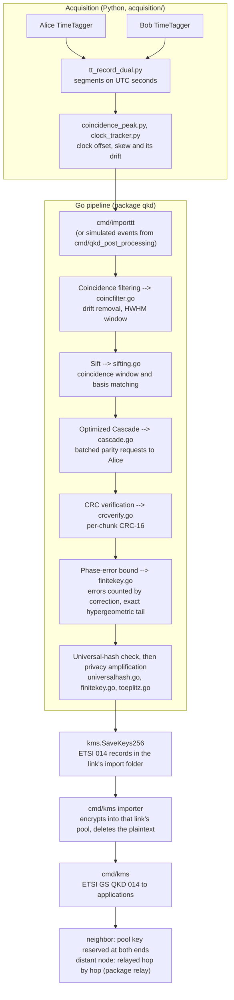
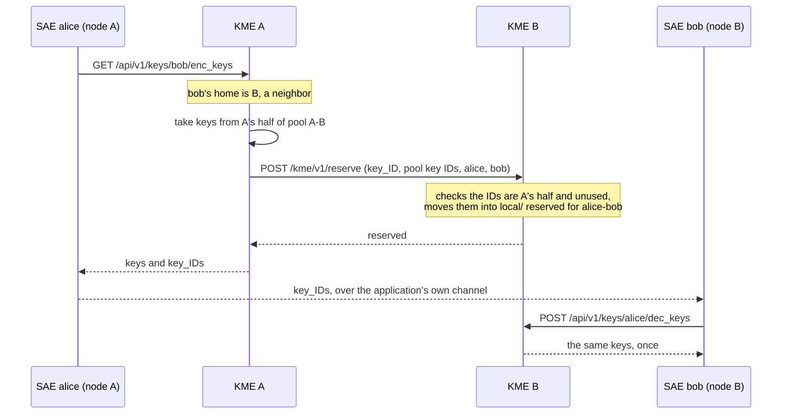

### Architecture

Scope: the structure of the codebase, meaning module boundaries, data flow, exported APIs and build and deployment mechanics. It is not a security proof: where a module makes a cryptographic or correctness claim, this document states it in one sentence and defers the justification to `security.md` and `key_management.md`. Code is cited by file and identifier, never by line.

### Overview

The repository implements the classical post-processing chain of a BBM92 entangled-photon QKD link and the key management system of a network of such links. Raw detector timestamps from two TimeTaggers go in; finite-key-certified secret keys come out, land in the pool of the QKD link that produced them, and are handed to applications through ETSI GS QKD 014, directly between neighbors or relayed across trusted nodes.

The chain has five stages: coincidence filtering and sifting, error correction with optimized Cascade, CRC verification, phase-error estimation, and a universal-hash check followed by privacy amplification. `RunCascade` composes them in one process; the two-party protocol (`twoparty.go`) runs the same stages split between two sites that exchange only public messages. Downstream of the key sit the key store (package `kms`), the relay (package `relay`) and the key management system itself (`cmd/kms`), one instance per node.

The Go module `qkd_post_processing` (`go.mod`) has three library packages: `qkd` (the post-processing chain), `kms` (the encrypted key store) and `relay` (hop-by-hop key relay, which imports `kms`); `qkd` imports neither. The one external dependency is `golang.org/x/crypto` (Poly1305). The Python under `acquisition/` writes the recordings `cmd/importtt` reads, and the node services in `services/` run both.

### Top-level layout

| Path | Purpose |
|---|---|
| `qkd/` | Package `qkd`: sifting, coincidence filtering, detector delays, optimized Cascade, CRC verification, finite-key privacy amplification, the two-party protocol, and their tests; `qkd/testdata/` holds fixed Toeplitz test vectors |
| `kms/` | Package `kms`: the encrypted key store with an in-memory index, single delivery, reservation for one SAE pair, wiping and tombstones; ETSI 014 key records |
| `relay/` | Package `relay`: hop-by-hop relay, one-time pad plus Poly1305 per hop, each end of a link drawing only from its own half of the pool |
| `cmd/kms/` | The key management system, one instance (KME) per node: ETSI GS QKD 014 for applications, pool coordination and relay between nodes, management, importer, audit trail |
| `cmd/qkdpki/` | The network's private CA, per-node credential bundles, application certificates, and edits to the shared network description |
| `cmd/controller/` | The network controller: desired nodes, links and settings, each node's config in answer to its agent's heartbeat, the network view and its stats |
| `cmd/importtt/` | CLI: the chain over real dual-TimeTagger recordings, single-site or one side of a two-party run |
| `cmd/qkd_post_processing/` | CLI: the chain over simulated click streams |
| `acquisition/` | Python: TimeTagger recording, clock alignment and tracking, the per-segment stream, coincidence log, CHSH diagnostic |
| `services/` | The node's services from one image, each on its own port: agent, acquisition, processing, web (`services.md`) |
| `ui/` | The dashboard page the web service serves: template, script, styles, logo |
| `api/` | OpenAPI 3.1 of the controller and the node services |
| `deploy/` | Docker deployment: `compose.yml` (one node), `controller.yml`, `lab.yml`, `Caddyfile`, `setup.sh`, `trust-ca.sh` |
| `evaluation/` | `evaluate.py`: every stage of the chain on chosen recordings, with figures |
| `.github/` | CI, weekly drift checks, image releases, Dependabot |
| `doc/` | This document and the formal procedures |
| `references/` | Vendor documents, local only: ignored by git and Docker and refused by the pre-commit hook |
| `scripts/` | `release.sh` (tags a release), `cross_check_toeplitz.py` (independent Toeplitz test vectors) |
| `Dockerfile`, `Makefile`, `go.mod`, `go.sum`, `ruff.toml`, `.golangci.yml` | Multi-stage build of the kms, app and tools images; `make` targets; module definition; lint settings |

### Data flow

Everything up to privacy amplification runs on one side's own bits plus the peer's public messages (timing, bases, Cascade's parities, CRCs, hash tags); the two sides never exchange raw key bits. `RunCascade` runs both sides together in one process, for single-site recordings and the simulator; in production the two sites run apart, `qkd/twoparty.go` implementing the protocol, `importtt -role alice|bob` each site's half, and the KMS mailbox carrying the messages (How a link's pools are filled in `key_management.md`).

### Pipeline stages

### Sifting

Purpose: from each side's clicks, find the basis-matched, unambiguous, single-photon coincidences, the only clicks that can contribute key bits.

| Identifier | Signature | File |
|---|---|---|
| `DetectionEvent` | `struct { TimestampPS int64; Basis Basis; Bit byte; MultiPhoton bool }` | `events.go` |
| `PublicEvent` | `struct { TimestampPS int64; Basis Basis; MultiPhoton bool }` | `sifting.go` |
| `StripBit` | `func StripBit(events []DetectionEvent) []PublicEvent` | `sifting.go` |
| `MatchCoincidences` | `func MatchCoincidences(alice, bob []PublicEvent, windowPS int64) []MatchedPair` | `sifting.go` |
| `Sift` | `func Sift(aliceEvents, bobEvents []DetectionEvent, windowPS int64) []SiftedBit` | `sifting.go` |

`MatchCoincidences` never needs a bit, only timestamp, basis and multi-photon flag: that is the point of the `PublicEvent`/`DetectionEvent` split. A click flagged `MultiPhoton` is excluded, and a click with more than one candidate partner in the window is dropped on both sides as ambiguous.

### Coincidence filtering

Runs in `cmd/importtt` after clock alignment and before sifting (`-filter`, on by default), specified in `coincidence_filtering.md`. It prunes Bob clicks that can never coincide, tracks the coincidence peak in 250 ms slices from public timing only, removes its drift, and sets the window half-width to the HWHM of a Gaussian fit to the corrected peak. `-dir a,b,c` pools recordings into one block; `-calibrate-delays` / `-detector-delays` measure and remove per-detector delays.

| Identifier | Signature | File |
|---|---|---|
| `PruneToCoincidenceRange` | `func PruneToCoincidenceRange(alice, bob []DetectionEvent, radiusPS int64) []DetectionEvent` | `coincfilter.go` |
| `EstimateDrift` | `func EstimateDrift(alice, bob []PublicEvent, cfg DriftConfig) (DriftModel, error)` | `coincfilter.go` |
| `FilterCoincidences` | `func FilterCoincidences(alice, bob []DetectionEvent, cfg DriftConfig, wc WindowConfig) ([]DetectionEvent, CoincidenceFilter, error)` | `coincfilter.go` |
| `CalibrateDetectorDelays` | `func CalibrateDetectorDelays(alice, bob []DetectionEvent, radiusPS int64) (DetectorDelays, []PairPeak, error)` | `detdelay.go` |
| `ApplyDetectorDelays` | `func ApplyDetectorDelays(events []DetectionEvent, delays [2][2]float64) []DetectionEvent` | `detdelay.go` |

### Error correction: optimized Cascade

Brassard-Salvail Cascade as optimized by Martinez-Mateo et al. (2015): the first block size from the QBER, blocks growing ×4 per pass, a shuffle per pass from a public seed, no parity disclosed twice, halves inferred from known parities, and corrections cascading back to earlier passes. Bob asks, Alice only answers: `CascadeAlice` answers parity requests, `CascadeBob` batches a whole pass's block parities into one request and then one request per halving step of all searches under way, about a hundred round trips per block.

| Identifier | Signature | File |
|---|---|---|
| `CascadeConfig` | `struct { Passes, FirstBlock int; BlockSizes []int; Seed int64 }` | `cascade.go` |
| `CascadeStats` | `struct { Passes int; BlockSizes []int; Parities, Inferred, Corrections, Searches, Rounds int }` | `cascade.go` |
| `CascadeOracle` | `interface { Parities(pass int, ranges [][2]int32) ([]byte, error) }` | `cascade.go` |
| `NewCascadeAlice` | `func NewCascadeAlice(bits []byte, seed int64) *CascadeAlice` | `cascade.go` |
| `CascadeBob` | `func CascadeBob(bob []byte, qber float64, cfg CascadeConfig, alice CascadeOracle) ([]byte, CascadeStats, error)` | `cascade.go` |
| `CascadeReconcile` | `func CascadeReconcile(alice, bob []byte, qber float64, cfg CascadeConfig) ([]byte, CascadeStats)` | `cascade.go` |
| `RunCascade` | `func RunCascade(aliceEvents, bobEvents []DetectionEvent, cfg CascadeRunConfig) (CascadeRunResult, error)` | `pipeline_cascade.go` |

Disclosure is exactly `CascadeStats.Parities`, every parity Alice revealed, each once; f is 1.03 to 1.08 over 1-11% QBER. By default no bit is sacrificed for the QBER: the errors Cascade corrects in each basis are counted and bound the other basis's phase errors (`SacrificeSample` and `-cascade-sample` spend a sample instead).

### Error verification

Purpose: a cheap second check over Cascade's output: CRC-16/CCITT-FALSE per chunk (`-chunk`, 16 bits disclosed per chunk), a chunk that differs being dropped at both ends and its bits counted as errors.

| Identifier | Signature | File |
|---|---|---|
| `ComputeChunkCRC` | `func ComputeChunkCRC(bits []byte, chunkSize int) []uint16` | `crcverify.go` |
| `ReconcileChunks` | `func ReconcileChunks(ownBits []byte, ownCRC, peerCRC []uint16, chunkSize int) ChunkReconcileResult` | `crcverify.go` |
| `CRCVerify` | `func CRCVerify(alice, bob []byte, chunkSize int) CRCVerifyResult` | `crcverify.go` |

CRC-16 alone bounds correctness only to about 2⁻¹⁶, which is why the universal-hash check runs right before privacy amplification.

### Phase errors, privacy amplification and the finite key

`security.md` is the authoritative procedure; this section names the API only.

| Identifier | Signature | File |
|---|---|---|
| `FiniteKeyConfig` | `struct { EpsSec, EpsCor float64 }` | `finitekey.go` |
| `FiniteKeyReport` | `struct { PhiPoint, Phi float64; TagBits int; Verified bool; ...; ChainBits int }` | `finitekey.go` |
| `SplitSecurityBudget` | `func SplitSecurityBudget(epsSec, epsCor float64) SecurityBudget` | `finitekey.go` |
| `HypergeomUpperRate` | `func HypergeomUpperRate(n, k, e int, eps float64) float64` | `finitekey.go` |
| `FiniteKeySecureKeyLength` | `func FiniteKeySecureKeyLength(n int, phi float64, leakedBits int, epsCor, epsPA float64) int` | `finitekey.go` |
| `OptimalSampleFraction` | `func OptimalSampleFraction(nSifted int, expectedQBER float64, fk FiniteKeyConfig) float64` | `finitekey.go` |
| `SecureKeyLength`, `PrivacyAmplify` | asymptotic length and Toeplitz hashing | `privacyamp.go` |
| `UniversalHashTagBits`, `ComputeUniversalHashTag`, `VerifyUniversalHash` | the correctness check, a $\log_2(1/\varepsilon_\text{cor})$-bit tag | `universalhash.go` |

The phase error of each basis's key bits is bounded from the other basis's errors with the exact hypergeometric tail (`HypergeomUpperRate`), plus the chain-rule cost when the errors are counted by correction (`ChainBits`); the strings are checked with the universal hash (no key on mismatch) and hashed to `FiniteKeySecureKeyLength`'s length. `-asymptotic` uses $n(1-h_2(\mathrm{QBER}))$ minus the disclosure instead, for comparison only. A bound at or above ½ yields no key. The Toeplitz hash runs on hardware carry-less multiplication where the CPU has it (`toeplitz_clmul_amd64.go`), else on POPCNT (`toeplitz.go`), both checked against a reference implementation and fixed test vectors.

### Two-party protocol

`RunAlice` and `RunBob` run the same stages between two sites over a `Conn` (the KMS mailbox in production, `PipeConns` in tests). Alice announces her clicks' timing, basis and multi-photon flag; Bob matches, sends the pair list, runs `CascadeBob` against Alice's answers, and both verify and privacy-amplify with seeds and key_IDs Alice picks. For a block streamed in segments, Alice runs from her bits and flags alone (`RunAliceClicks`) and Bob from the announced clicks that can pair, each with its index in the whole announcement (`TwoPartyConfig.AnnouncementIndex`), so his pair list names the same clicks the whole announcement would.

### Window reporting

`ReportWindowQuality` (`windowreport.go`, `cmd/importtt -window-report`) buckets the sifted pairs by time and reports each bucket's own QBER, as a diagnostic only: it never selects which bits become key, since choosing after seeing per-bucket QBER would bias the phase-error estimate.

### Key store

`KMS` is one encrypted store: one JSON record per `key_ID` in a directory, indexed in memory when the store opens, so every lookup, draw and status call reads the index rather than the disk. A node has several: its delivery store (keys reserved for application pairs) and one pool per QKD link.

| Identifier | Signature or shape | File |
|---|---|---|
| `kmsRecord` (unexported) | `struct { KeyID, Ciphertext string; CreatedAt, ExpiresAt time.Time; Consumed bool; ConsumedAt time.Time; MasterSAE, SlaveSAE string }` | `kms.go` |
| `NewKMS` | `func NewKMS(dir string, masterKey []byte) (*KMS, error)` | `kms.go` |
| `(*KMS) Put`, `PutWithID` | `func (k *KMS) PutWithID(keyID string, keyBytes []byte, ttl time.Duration) error` | `kms.go` |
| `(*KMS) PutReserved` | `func (k *KMS) PutReserved(keyID string, keyBytes []byte, master, slave string, ttl time.Duration) error` | `kms.go` |
| `(*KMS) Get`, `GetReserved`, `CheckReserved` | `func (k *KMS) GetReserved(keyID, master, slave string) ([]byte, error)` | `kms.go` |
| `(*KMS) GetNext`, `GetNextMatching` | `func (k *KMS) GetNextMatching(n int, match func(string) bool) ([]DeliveredKey, error)` | `kms.go` |
| `(*KMS) GetNextBytes`, `GetNextBytesMatching` | `func (k *KMS) GetNextBytesMatching(n int, match func(string) bool) ([]byte, []string, error)` | `kms.go` |
| `(*KMS) GetBytes` | `func (k *KMS) GetBytes(ids []string, n int) ([]byte, error)` | `kms.go` |
| `(*KMS) Status`, `CountAvailable`, `AvailableIDs` | counts and IDs only, never key material | `kms.go` |
| `(*KMS) Sweep` | `func (k *KMS) Sweep() (int, error)` | `kms.go` |
| `OriginatorOf` | `func OriginatorOf(self, peer string) func(string) bool` | `kms.go` |
| `SaveKeys256`, `SaveKey`, `LoadKey`, `NewKeyID` | plaintext ETSI 014 records, the pipeline's output format | `keystore.go` |
| `EncryptWithKey`, `DecryptWithKey` | AES-256-GCM with an HKDF-SHA256-derived key | `encryption.go` |

Records are AES-256-GCM under the node's 32-byte master key, written atomically (temporary file, sync, rename) with mode `0o600` in a `0o700` directory. Delivery is single: taking a key wipes its ciphertext from disk and leaves a tombstone, `Sweep` does the same for expired keys, and a tombstoned `key_ID` can never be stored again. A key stored with `PutReserved` is invisible to every draw and goes only to its own master and slave SAE pair. `GetBytes` checks every listed ID before consuming any, so a bad list consumes nothing, and `GetNextBytesMatching` consumes nothing when the pool cannot cover the request. `OriginatorOf` splits a link's pool between its two ends by the parity of the first hex digit of each `key_ID`; the two ends' filters are exact complements, so no pool key is ever drawn by both.

### Key management system

One instance per node, the node's KME. It reads the network description every node shares (`network.json`: nodes and their KME URLs, QKD links, and the home node of every application), derives its neighbors and shortest-path routes from it (`nextHops`, breadth-first, ties to the alphabetically first neighbor), and opens `local/` plus `pools/<neighbor>/` under its data directory. `key_management.md` specifies the protocols; this section lists the surface.

| Route | Caller | Handler, file | Does |
|---|---|---|---|
| `GET /api/v1/keys/{slave}/status` | SAE of this node | `handleStatus`, `etsi.go` | ETSI Get Status for the pair, with the count deliverable now |
| `GET` or `POST /api/v1/keys/{slave}/enc_keys` | SAE of this node | `handleEncKeys`, `etsi.go` | ETSI Get Key: up to 128 keys, sizes multiples of 256 bits |
| `GET` or `POST /api/v1/keys/{master}/dec_keys` | SAE of this node | `handleDecKeys`, `etsi.go` | ETSI Get Key with Key IDs: every ID checked before any is delivered |
| `POST /kme/v1/reserve` | neighbor KME | `handleReserve`, `relay.go` | holds named pool keys of the sender's half for one SAE pair |
| `POST /kme/v1/relay` | the neighbor named in the packet | `handleRelay`, `relay.go` | authenticates, decrypts, stores (destination) or forwards |
| `GET /kme/v1/node` | any KME, or this node's admin | `handleNode`, `node.go` | counts per store and link; `?probe=1` (admin) checks every neighbor |
| `GET /kme/v1/network`, `/kme/v1/audit` | this node's admin | `handleNetwork`, `handleAudit`, `node.go` | the network description and routes; the newest audit events |
| `POST /kme/v1/pp/send`, `GET /kme/v1/pp/recv`, `GET /kme/v1/pp/sessions` | this node's admin | `mailbox.go` | two-party post-processing messages to and from a neighbor's dashboard |
| `POST /kme/v1/pp/inbox` | neighbor KME | `handlePPInbox`, `mailbox.go` | queues a neighbor's post-processing message |

Callers are identified by their client certificate alone: the organizational unit gives the role (`kme`, `sae` or `admin`) and the common name the ID, so an application certificate can never act as a node, a node never as an application, and a dashboard never as its node. Every answer from a peer is checked to come from the node it was sent to (`kmePost`, `relay.go`). Requests are capped at 1 MiB, post-processing messages at 128 MiB. Without `-tls-cert`, `-tls-key` and `-tls-ca` the server refuses to start unless `-insecure-plain-http` is given, which takes identities from headers and exists for development only.

For a slave whose home is not a neighbor, `relay.RelayNode.OriginateFromPool` takes the key from the master's half of the first link's pool and sends the first hop only its key_IDs, then `POST /kme/v1/relay` carries it hop by hop; the destination stores it reserved for the pair and answers with the `key_ID` the origin chose, and only then does the origin hand the key out. If the peer does not confirm, the keys already taken are destroyed and logged as burned, never delivered. `importKeys` (`node.go`) moves settled plaintext records from `<import-root>/<neighbor>/` into that link's pool every two seconds and deletes each file once it is stored encrypted; `runSweeper` wipes expired material every ten minutes; `auditLog` (`audit.go`) appends one JSON line per key event, with key and SAE IDs only.

### Relay

| Identifier | Signature | File |
|---|---|---|
| `RelayNode` | `struct { ID string; Local *kms.KMS; HopPools map[string]*kms.KMS; NextHop map[string]string }` | `relay.go` |
| `RelayedPacket` | `struct { Dest, FromHop, Origin, KeyID, MasterSAE, SlaveSAE string; PadKeyIDs, MACKeyIDs []string; Cipher, Tag []byte }` | `relay.go` |
| `(*RelayNode) Originate` | `func (n *RelayNode) Originate(dest, keyID, master, slave string, keyBytes []byte) (RelayedPacket, error)` | `relay.go` |
| `(*RelayNode) Receive`, `Handle` | `func (n *RelayNode) Handle(pkt RelayedPacket) (delivered bool, keyID string, next RelayedPacket, err error)` | `relay.go` |
| `RelayXOR` | `func RelayXOR(payload, pad []byte) ([]byte, error)` | `relay.go` |
| `ComputePolyMAC`, `VerifyPolyMAC` | Poly1305 under a single-use 32-byte key, constant-time comparison | `polymac.go` |

Each hop takes the pad and the MAC key in one draw from its own half of the pool shared with the next hop (`forward`), so a short pool consumes nothing. The MAC covers every field an attacker could change, destination, sender, origin, end-to-end `key_ID`, SAE pair, pad key IDs and ciphertext, each length-prefixed (`macMessage`). `Receive` refuses a packet whose pad or MAC keys come from the receiver's own half before consuming anything, verifies the tag before decrypting, and wipes pad and key buffers after use. A packet carries key IDs, never key material, and an intermediate node keeps nothing once it has forwarded.

### Build, test and deployment

### Makefile targets

| Target | Command | Purpose |
|---|---|---|
| `build` | `go build ./...` | compile everything |
| `test` | `go test -race -count=1 ./...` | the Go test suite, race detector on |
| `lint` | golangci-lint, `ruff check .` | Go and Python lint, as CI runs them |
| `pytest` | `python3 -m unittest ...` | the services' and acquisition's Python tests |
| `services` | `python3 -m services all` | every node service in one process, for development |
| `bench` | `go test -run '^$' -bench . -benchmem ./...` | benchmarks only |
| `run` | `go run ./cmd/qkd_post_processing -n 300000 -err 0.005 -chunk 3000` | demo run |
| `vet`, `fmt` | `go vet ./...`, `gofmt -l .` | static analysis, formatting check |
| `check` | `fmt vet build test lint pytest` | what CI runs, locally |

### Commands

| Binary | Source | What it does |
|---|---|---|
| `kms` | `cmd/kms/` | the key management system of one node, see above |
| `controller` | `cmd/controller/` | the network controller (`services.md`): `state.go` the desired network and each node's config, `api.go` heartbeat, network view, events and stats, `main.go` mutual TLS |
| `qkdpki` | `cmd/qkdpki/main.go` | `ca` (network CA), `node` (kms, app and ui credentials plus master key), `sae` (application certificate), `controller` (controller and operator certificates), `net` (edit `network.json`) |
| `importtt` | `cmd/importtt/main.go` | loads a real recording (`npy.go`), aligns clocks with `coincidence_peak.py`'s affine model, maps channels to basis and bit, filters coincidences, runs optimized Cascade, verification and privacy amplification; `-role alice|bob` runs one site's half of a two-party run; `-dir a,b,c` pools recordings, `-calibrate-delays` and `-detector-delays` handle per-detector delays, `-keystore` writes the key as ETSI records, `-json` prints one report |
| `qkd_post_processing` | `cmd/qkd_post_processing/main.go` | simulates correlated click streams (`simulate`) and runs the same chain |

### Images

One multi-stage file. The `build` stage cross-compiles every command with `CGO_ENABLED=0` on the build machine's own architecture for the target's (`--platform=$BUILDPLATFORM`, `GOARCH=$TARGETARCH`), so amd64 and arm64 nodes build from the same file. Target `kms` is the `kms`, `controller` and `qkdpki` binaries on a distroless static base, no shell, non-root. Target `app` is Python 3.12 slim with the `services` package, the dashboard page, the acquisition scripts and the `importtt` and `qkd_post_processing` binaries; `SERVICE` picks which service a container runs, under gunicorn with one worker (jobs, caches and the TimeTagger's processes live in it) and several threads, with a health check on its own `/healthz`. Target `tools` adds every binary, for offline analysis. `.dockerignore` keeps credentials, recordings, keys, `deploy/`, `doc/` and `references/` out of the build context.

### One node

`compose.yml` runs the node's containers, each read-only, without Linux capabilities (the front end keeps only the one its binary carries), with no-new-privileges, as the installing user, and with only its own credentials and data mounted: `kms` (`pki/kms`: node certificate, node key, master key), the four services of the `app` image (`pki/app`: the admin certificate and the dashboard's SAE certificate, never the node key or the master key) and `ui` (Caddy with `pki/ui`, a server-only certificate from the network CA, and the node's login). `controller.yml` runs the network controller. `setup.sh` drives everything with Docker alone: `ca`, `node`, `link`, `sae`, `bundle` and `controller` on the administration machine, `install`, `use-controller`, `up`, `down`, `logs` and `status` on a node. `deployment.md` is the operator's guide.

### Node services

`services/` is one Python package, four services: `agent` (controller link, two-party schedule, monitor, alerts, KMS pages), `acquisition` (everything driving the TimeTagger), `processing` (alignment, jobs, evaluations, CHSH, simulator, block work) and `web` (the page and a streaming proxy of every `/api` call to its owner). Each package lists its Flask blueprints and starts its threads; `serve.create_app(name)` builds one service, or all of them in one process. `services.md` describes each module, how the services call each other (HTTP with a service token, shared data folders) and the API files in `api/`. The page loads no inline script (`script-src 'self'`), and every server string is escaped before display (`esc`, `main.js`).

### Acquisition scripts

Three Python scripts, run in sequence, bridge real hardware to `cmd/importtt`:

- `tt_stream_external.py` --> vendor-provided TimeTagger network client (`TimeTaggerStream`: `connect`/`start_stream`/`read_stream`), included as provided.
- `tt_record_dual.py` --> connects to two TimeTaggers (configured in `acquisition/config.json`), starts both recording behind one `threading.Barrier` so the two capture windows begin at the same instant, and writes per-side `*_timestamp_sequence.npy` (int64 picoseconds) + `*_channel_sequence.npy` (int8 physical channel, 1-4) + `*_meta.json`. It also feeds every frame to the live tracker (`live_peak.py`), which locks onto the coincidence peak with a joint lag and clock-skew search and then follows it chunk by chunk, for the operator and the dashboard; the final alignment still comes from `coincidence_peak.py` over the whole recording.
- `coincidence_peak.py` --> computational core of alignment: FFT cross-correlation for a coarse lag estimate, exact-timestamp-difference refinement for picosecond precision, and a segmented linear fit for clock skew (drift). Writes `<dir>_coincidence.json`, which records the fitted affine clock model (`ClockSkew.ReferenceElapsedPS`/`LagAtReferencePS`/ `SkewFraction`) that `cmd/importtt` inverts (`toAliceClock`, `cmd/importtt/main.go`) to map every Bob timestamp onto Alice's clock before sifting. `cmd/importtt` refuses to run against a report whose `"detected"` field is `false` (`findRecording`, `cmd/importtt/main.go`).

`chsh_diagnostic.py` is a separate, standalone diagnostic (CHSH/Bell self-testing statistics) over the same aligned recording; it is not part of the key-generation chain and its output does not feed `cmd/importtt`.
