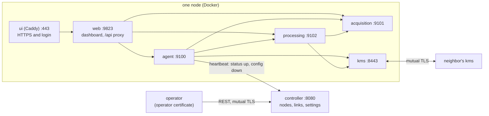

## Services

How the software is split: one central controller for the whole network, and on every node a key management system plus four services that all run from the same image, each on its own port. Every part has its own OpenAPI file in `api/`, answers `/healthz` and `/readyz`, and reports its numbers on `/metrics`.

### Controller

`cmd/controller`, one instance for the network, run from the `kms` image with `--entrypoint controller` (`deploy/controller.yml`). It holds the network as the operator wants it and nothing else: the nodes (each with the site its TimeTagger has in that node's acquisition config, and whether it takes part), the links (the two nodes, which one announces, whether it runs) and the settings every node shares (segment and block length, expected QBER, blocks kept on disk). That desired state is the only thing on disk (`network.json`, written atomically); what the nodes report lives in memory.

**Southbound**: every node's agent sends a heartbeat every 10 s (`POST /v1/agents/{id}/heartbeat`) with its status: which services answer, whether the recorder runs, its alerts, the last block of every link and both halves of every pool. The answer is the config that node must apply: whether continuous QKD runs, its site, the neighbors it announces to and the shared settings. A node runs continuous QKD while it is enabled and has at least one active link to an enabled neighbor, and announces on the links where it is the announcer.

**Northbound**: the operator reads the whole network (`GET /v1/network`: desired state, each node's config, its last status and whether it is up), follows it live (`GET /v1/events`, server-sent events on every change and at least every 15 s), and changes it (`PUT` and `DELETE` on `/v1/nodes/{id}` and `/v1/links/{name}`, `PUT /v1/settings`). Every change is checked (known nodes, the announcer one of the link's two, block length a whole number of segments) and bumps the revision.

**Who may call what**: callers are told apart by their certificate from the network CA, as the KMS does. Organizational unit `operator` changes the network; `admin` with the node ID as common name is that node's agent, which may send only its own heartbeat and read the network. `qkdpki controller` issues the controller's server certificate and one operator certificate.

**A node the controller does not know** runs on its own settings, from its dashboard. A node the controller manages refuses Start and Stop on its dashboard and says so; the only node-local setting kept is a replay recording for tests.

### Agent

`services/agent`, port 9100: the node's link to the controller and to its neighbors.

- **controller.py**: the heartbeat and applying the config that comes back; `/api/controller` shows the link's state.
- **twoparty.py**: the continuous two-party settings and their schedule: every block both sites have finished is queued at the processing service toward each neighbor this node announces to, and marked done only once the processing service took it, so nothing is lost while it restarts.
- **listener.py**: notices a neighbor's session in the KMS mailbox and hands it to the processing service: a manual announcement becomes a Bob job, a continuous block goes to the block queue.
- **live_status.py**: exchanges the current singles with every neighbor every two seconds, for the monitor.
- **monitor.py**, **alerts.py**: the link monitor, the alerts and the watchdog that restarts the recorder.
- **kms_api.py**: the key management pages, through the node's admin and dashboard SAE certificates.

### Acquisition

`services/acquisition`, port 9101: everything that drives the TimeTagger, which serves one mode at a time (`tagger.py` holds that lock): the acquisition config, uploads and stored recordings, recordings and replays through the live tracker, lab continuous QKD, the coincidence log, and the two-party recorder (`/v1/recorder`), which records this node's TimeTagger without end in UTC-aligned segments, reports the singles of every read and every segment, and drops segments no block will need.

### Processing

`services/processing`, port 9102: everything that turns recordings into analysis and keys. Alignment of any pair (cached per pair and file version), background jobs one at a time (extraction, calibration, evaluation, manual two-party halves; each kind registers itself in `jobs.py`), evaluations, the CHSH diagnostic, the simulator, and the block work of continuous two-party QKD (`blocks/`: Alice's and Bob's sides of a block, streamed segment by segment as they close with one worker per neighbor and role, and the block log every link's history is read from). Keys go to the import folder the KMS reads from; `importtt` talks to the neighbor through the KMS mailbox with the node's admin certificate.

### Web

`services/web`, port 9823: the dashboard page and a proxy that hands each `/api` call to the service that owns it (`ROUTES` in `proxy.py` is the whole map), streamed both ways so recordings of many gigabytes never sit in memory. Caddy in front adds HTTPS and the login; the browser never talks to the other services.

### Between the services

**Calls**: plain HTTP inside the node's Docker network, JSON in and out (`services/core/peers.py`). `AGENT_URL`, `ACQUISITION_URL` and `PROCESSING_URL` say where each one listens.

**Token**: every inner service refuses a call without the node's `SERVICE_TOKEN` in `X-Service-Token`, except health, readiness and metrics; `setup.sh node` writes a random one into the node's `.env`.

**Data**: the services share the node's data folders by mounting only what each needs: acquisition and processing the recordings, runs and config, the agent the config and stats, the web service none. Recordings never cross a service boundary over HTTP except as an upload.

**All in one**: `python -m services all` (and `SERVICE=all`) serves every route from one process on 9823, with the page and without the proxy, for development and tests (`make services`).

### Code layout

| Path | Contents |
|---|---|
| `services/core/` | settings, the web base (security headers, token, health, readiness, metrics), the KMS and service clients, recordings, pipeline flags, process helpers |
| `services/agent/`, `acquisition/`, `processing/`, `web/` | one module per page or task; each package lists its blueprints and starts its threads |
| `services/serve.py` | builds one service's app; `services/__main__.py` runs it under gunicorn on its port |
| `services/tests/` | every route against its OpenAPI file, the proxy map, the token, streaming through the proxy, the agent's schedule and the controller's settings |
| `cmd/controller/` | the controller: desired state, heartbeat, network view, events, stats |
| `api/` | OpenAPI 3.1 of the controller and of the agent, acquisition and processing services |

### Monitoring

Every service answers `GET /metrics` with its numbers as flat JSON (`services/core/metrics.py`: requests by status class and gauges such as `recorder_running`, `block_qber_<neighbor>`, `block_key_bits_<neighbor>`, `alerts_critical`), and the controller answers `GET /v1/stats` for the network (nodes up, per link QBER and key bits). Hooking these into the lab's monitoring system (LibreNMS) is left for later.

### CI and releases

**ci.yml** (every push and pull request): Go on the version `go.mod` declares and the newest (gofmt, `go mod tidy -diff`, vet, build, race tests, cross-architecture build), golangci-lint, govulncheck, gosec to code scanning, ruff, the OpenAPI files, the Python tests, both images, the controller answering, and the lab stack started from the image with every service reached through the web service.

**drift.yml** (weekly): new vulnerabilities in Go, the standard library and the Python packages, newer modules, and a fresh build of every image from current base images.

**release.yml**: started by hand only (Actions tab, or `gh workflow run release.yml -f tag=vX.Y.Z`), never by a push: publishes the `kms` and `app` images of that version tag to GitHub Container Registry for amd64 and arm64 and creates the GitHub release. `scripts/release.sh patch|minor|major` checks the tree and the tests and pushes the tag; publishing is the separate step after it.

**Dependabot**: monthly, one grouped pull request each for Go modules, Python packages, base images, compose images and Actions.

**Nodes from a registry**: in the node's `.env`, `APP_IMAGE=ghcr.io/<owner>/<repo>/app`, `KMS_IMAGE=ghcr.io/<owner>/<repo>/kms` and `IMAGE_TAG` (a released version), then `NO_BUILD=1 ./setup.sh up <ID>`, which pulls them.
